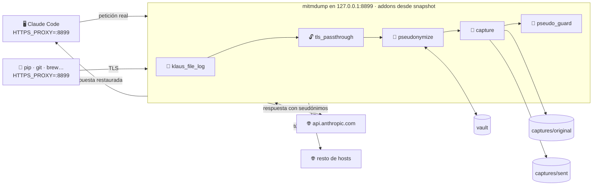

# 🏗️ Arquitectura — Klaus Proxy Local

> Cómo está construido el proxy y qué garantiza. Para operarlo, ve al [runbook técnico](./anthropic-audit-proxy.md); para usarlo, al [inicio rápido](./QUICK_START.md).

**Versión:** v0.7.0

---

## 🗺️ Visión general

El proxy es `mitmdump` (mitmproxy) con **cinco addons**, lanzado por `claude-proxy`. Solo escucha en loopback. Todo el estado vive en `~/.klaus-proxy/` y la CA en `~/.mitmproxy/`.

---

## 🚀 Arranque: `claude-proxy` (`launcher.py`)

1. **Configuración** (`setup.py`): crea `~/.klaus-proxy/config.json` con una SALT aleatoria si no existe, y exporta la SALT al entorno de `mitmdump`.
2. **Org/repo y carpeta de proyectos**: si se arranca dentro de un repo, guarda su org/repo en `pseudo_word_literals` (#61) y añade un `pseudo_patterns` para la carpeta que lo contiene (#42).
3. **Certificados** (`certs.py`): genera la CA de mitmproxy si falta, y escribe `ca-bundle.pem` (CAs del sistema + CA del proxy) y `klaus-env.sh`.
4. **Snapshot de addons** (`addons_snapshot.py`, #71): copia los cinco addons a `~/.klaus-proxy/addons/<hash>/` (ficheros `0400`). mitmproxy recarga los scripts cuando cambian en disco; ejecutarlos desde el clon permitía que un `git checkout` cambiase o rompiese el pseudonimizador en marcha.
5. **Panel de arranque**: commit de los addons, org/repo protegidos y `pseudo_patterns` activos.
6. **`mitmdump`** con los addons en este orden y `--listen-host` en loopback (#47). Ctrl+C o SIGTERM lo paran limpiamente (#51).

---

## 🧩 Addons

### 📝 `klaus_file_log.py` (#55)

Primero, para registrar también lo que los demás registran al cargar. Escribe `~/.klaus-proxy/logs/proxy.log` (o `KLAUS_LOG_DIR`), sin colores, rotado 5 MB × 5, con una línea por petición.

### 🔓 `klaus_tls_passthrough.py` (#116)

Decide en el ClientHello de cada conexión TLS si se descifra:

- **Se descifra solo lo que se audita** (#125): `api.anthropic.com` y sus subdominios, los `hosts` y `capture_only_hosts` de `config.json` (o `ANTHROPIC_PSEUDO_HOSTS` / `ANTHROPIC_CAPTURE_HOSTS`) y el host de `ANTHROPIC_BASE_URL` (del entorno o de `~/.claude/settings.json`). Pasan por los addons siguientes. Nada sale descifrado sin quedar capturado; hasta #125 se descifraban todos los subdominios de `anthropic.com` y `claude.ai`, y algunos (`mcp-proxy`, `downloads`, `platform`) salían sin pseudonimizar ni capturar.
- **El resto va en túnel** (`ignore_connection`): mitmproxy reenvía los bytes sin descifrar y el cliente ve el certificado real del servidor, así que pip, git, brew o gh no dan errores de certificado aunque no confíen en la CA del proxy. En `proxy.log` queda `TÚNEL host:puerto (sin descifrar)`: host y hora, no contenido.

Al cargar registra `🔓 Se descifra solo: …`. `"intercept_all": true` en `config.json` o `KLAUS_INTERCEPT_ALL=1` lo descifran todo, como antes de v0.6.0.

- **Si no carga,** mitmproxy lo descifra todo: falla hacia el lado seguro (errores de certificado en otras herramientas, nunca tráfico de la API sin pseudonimizar).
- **Contrapartida:** la defensa de «host desconocido con ruta de LLM» del pseudonimizador solo ve lo descifrado. Un gateway LLM que no esté en `hosts` ni en `ANTHROPIC_BASE_URL` iría en túnel sin pseudonimizar.

### 🔐 `anthropic_payload_pseudonymize.py`

**Petición** (hosts de `hosts` en `config.json`, por defecto `api.anthropic.com`; un host desconocido con ruta de LLM también se pseudonimiza, con un aviso, si se descifra: ver `klaus_tls_passthrough`). Los `capture_only_hosts` (#125) no se tocan: la petición sale tal cual y solo se deja a la captura el cuerpo con los secretos redactados. Recorre el JSON y aplica a cada texto, en este orden:

| # | Regla | Resultado | Reversible |
| --- | --- | --- | --- |
| 0 | Secretos reconocibles (claves privadas, AWS, Google, GitHub, Slack, JWT); `clave=valor` solo con `ANTHROPIC_PSEUDO_SECRET_KV=1` | `«REDACTED:<tipo>»` | ❌ |
| 0b | `pseudo_patterns`: carpeta de proyectos (`dir_…`) y usuario de `/Users/<u>` o `/home/<u>` (`user_…`), ignorando marcadores y nombres genéricos (#92) | grupo 1 → seudónimo | ✅ |
| 1 | Prefijos de ruta: raíz del repo (`/proj_…`) y home (`/home_…`) | seudónimo de ruta | ✅ |
| 2 | `pseudo_literals` y usuario/identidad git | `id_…` | ✅ |
| 3 | Emails e IPv4 (octetos 0–255; no tras `version=`) | `email_…`, `ip_…` | ✅ |
| 4 | `pseudo_word_literals` (org/repo y tus tokens), con frontera de palabra | `org_…` | ✅ |
| 5 | Nombres de carpeta del vault fuera de una ruta (≥ 5 caracteres, no genéricos, #93) | `dir_…` | ✅ |

- **Seudónimo** = prefijo + 8 hex de `SHA-1(SALT + valor)`: el mismo valor tiene siempre el mismo seudónimo en la misma máquina.
- **Aprendizaje por petición** (#63): extrae el org/repo de los remotes que Claude Code envía en `safeguards…git_state` y los añade a `pseudo_word_literals`. Solo llega en los modos de permisos `auto` y `plan` (#68).
- Marca la petición como procesada (`klaus_pseudo_seen`) para el guardián.

**Respuesta**: sustituye cada seudónimo del vault por su valor real. En streaming (SSE), concatena los deltas de cada bloque antes de restaurar, porque un seudónimo puede llegar partido entre dos fragmentos (#67).

**Vault** (`captures/.pseudonym_vault.json`, `0600`): JSON plano `{"valor real": "seudónimo"}`. **Contiene los valores reales**. Solo da el seudónimo de algo que ya casó con una regla: un valor que solo está en el vault no se protege (salvo las carpetas `dir_…` del paso 5).

### 📸 `anthropic_payload_capture.py`

Guarda cada petición a un host auditado como un par con el mismo nombre: `captures/original/` (antes de pseudonimizar; las cabeceras de autenticación, redactadas) y `captures/sent/` (lo que salió). Ficheros `0600`.

### 🚧 `klaus_pseudo_guard.py` (#71)

Último. Si una petición no lleva la marca del pseudonimizador (no está cargado o falló al recargarse), responde **502** y la petición no sale. Es lo que hace el proxy *fail-closed*. Además, si el pseudonimizador no consigue reescribir un cuerpo, aborta la petición en lugar de dejarla salir con el original.

> `ANTHROPIC_PSEUDO_ENABLE=0` **no** activa el guardián: el pseudonimizador está cargado (marca la petición) pero no sustituye nada, así que las peticiones salen sin pseudonimizar. Es un interruptor deliberado.

---

## 🔍 Herramientas fuera del proxy

No corren dentro de `mitmdump`; trabajan sobre las capturas o sobre tu disco:

| Herramienta | Qué hace |
| --- | --- |
| `src/anthropic_pair_verify.py` | Compara cada `original` con su `sent` y marca los valores reales que hayan salido, por capas (email, IPv4, ruta, identidad, org, `pattern`, `dir`, vault) |
| `klaus-audit-dashboard` | 5 planes de auditoría, histórico en `informes/` y avisos de prompt injection |
| `klaus-scan` (`sensitive_data_scanner.py`) | Busca secretos en una carpeta: patrones, contexto (nombres de variable, `.env`) y entropía. Lo aprobado va al vault y a `config.json` (#99) |
| `scripts/prune_vault.py` | Quita del vault valores que los patrones ya ignoran (#92) |

---

## ✅ Garantías y límites

**Garantiza:**
- Ninguna petición a un host auditado sale sin pasar por el pseudonimizador (guardián).
- El proxy en marcha no cambia aunque cambie el código del clon (snapshot).
- Mismo valor → mismo seudónimo; la respuesta llega a Claude Code con los valores reales.
- Solo escucha en loopback.
- Evidencia local de cada petición (`original` + `sent`), nunca versionada.

**No garantiza:**
- Proteger lo que **ninguna regla** reconoce: un nombre de cliente o un dato sin forma reconocible sale en claro hasta que lo añadas a `config.json`. `anthropic_pair_verify.py --survivors` ayuda a encontrarlos.
- Una carpeta suelta en el texto solo se protege cuando el vault ya la conoce.
- El vault y `original/` contienen los datos reales: su seguridad es la de tu cuenta de usuario.
- Revertir lo ya enviado.
