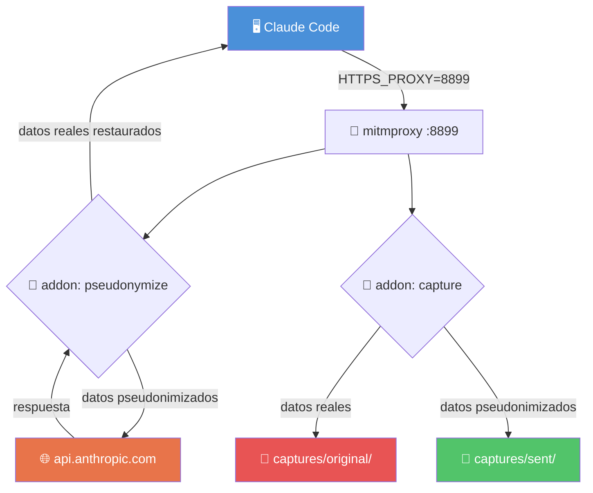

# 🏗️ Arquitectura

## 📋 Contexto

Aquí vive todo lo que explica **cómo está construido** Klaus Proxy Local. Como los planos de un edificio: antes de tocar el código, hay que saber qué hay dónde y por qué está así.

---

## 📄 Documentos

| Documento | Descripción |
|---|---|
| [🔬 Architecture Deep Dive](../ARCHITECTURE_DEEP_DIVE.md) | Análisis profundo de todos los componentes internos |
| [🔌 Anthropic Audit Proxy](../anthropic-audit-proxy.md) | Runbook técnico completo del proxy: flags, modos y operación |
| [⚙️ Setup & Configuración](../setup.md) | Configuración técnica detallada: variables, rutas, dependencias |

---

## 🔄 Flujo de alto nivel

> 💡 **Cómo leerlo:** Klaus se sienta entre Claude Code y la API como un guardia de seguridad en la puerta. Deja pasar todo, pero revisa el contenido, lo pseudonimiza antes de que salga y guarda una copia de lo que llegó vs. lo que salió.

---

## 🔗 Referencias

← [Volver al README principal](../../README.md)
