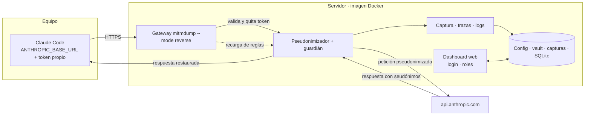

# 🧭 Evaluación funcional: del proxy local a un servidor con dashboard

## 📋 Contexto

La issue [#131](https://github.com/Ka0s-Klaus/klaus-proxy-local/issues/131) evalúa una **versión servidor** del proxy: un gateway central para un equipo pequeño (5–30 personas), gestionado desde un dashboard web. Las decisiones D1–D9 ya están tomadas en la issue.

Este documento responde a una pregunta concreta: **¿qué funcionalidades del proxy local pueden pasar al servidor, cuáles hay que adaptar y cuáles no tienen sentido allí?** Es una evaluación de documentación. **No inicia la fase 0** (pruebas de concepto), que sigue pendiente de decisión.

Cada funcionalidad se clasifica con una de estas etiquetas:

| Etiqueta | Significado |
|---|---|
| ♻️ **Reutilizar** | Sirve tal cual en el modo gateway. |
| 🔧 **Adaptar** | La lógica sirve, pero depende de la máquina local o de un único usuario. |
| 🚫 **No aplica** | Solo tiene sentido en el equipo local, o el modo gateway la hace innecesaria. |
| 🆕 **Construir** | No existe hoy y hay que crearla. |

---

## 🔍 Descripción detallada

### 1. Núcleo de protección (la parte difícil, ya existe)

| Funcionalidad | Dónde está | Veredicto | Notas para el servidor |
|---|---|---|---|
| Pseudonimización bidireccional de peticiones y respuestas (incluido SSE) | `src/anthropic_payload_pseudonymize.py` | ♻️ | Funciona igual en modo `reverse` (#131, D2). |
| Guardián fail-closed: bloquea cualquier petición no pseudonimizada | `src/klaus_pseudo_guard.py` | ♻️ | Crítico en el servidor: sin él, una recarga fallida deja salir datos a todo el equipo. Ver P7. |
| Reglas de privacidad deducidas de la máquina (ruta del home, usuario del SO, git, remotes) | `build_rules` en el pseudonimizador | 🔧 | En un servidor serían datos del servidor, no de cada usuario. Sustituir por **perfil por usuario** en el dashboard (P2). |
| Reglas de literales, palabras, patrones y secretos (`pseudo_literals`, `pseudo_word_literals`, `pseudo_patterns`, `secret_regexes`) | `config.json` + `Rules` | 🔧 | Sirven. Pasan a editarse desde el dashboard con validación (P5) y recarga en caliente (P6). |
| Aprendizaje de org/repo por petición (`learn_repo_tokens` → `add_word_literals_to_config`) | pseudonimizador | 🔧 | **Escribe `config.json` desde el gateway.** Con el dashboard escribiendo también, una escritura puede pisar a la otra. Un único dueño de cada dato (P6). |
| Detección de secretos en el payload | `sensitive_data_scanner.py` | 🔧 | Las reglas auto-aprendidas sirven. El escaneo de repos en disco no aplica al servidor (ver §3). |

### 2. Captura, trazas y auditoría

| Funcionalidad | Dónde está | Veredicto | Notas para el servidor |
|---|---|---|---|
| Captura `original/` y `sent/` por petición | `src/anthropic_payload_capture.py` | ♻️ 🔧 | Se reutiliza. Hay que añadir el **usuario** a cada registro. Opción de no guardar `original/` (D8, P3, P13). |
| `capture_only_hosts` | `config.json` | ♻️ | Pierde sentido: en el gateway solo llega tráfico de la API. |
| Retención y borrado de capturas | `src/Klaus_proxy_local/capture_retention.py` (#132) | ♻️ | Imprescindible en el servidor por el volumen (P13: ~1,5 MB por par). |
| Trazas por llamada con `trace_id`, hashes y métricas de rendimiento | `klaus_trazas_addon.py`, `trazas.py`, `trace_stats.py` (#232, #234) | ♻️ | Se añade el usuario atribuido. Las métricas de conexión (`connection_reused`) habrá que re-medirlas en modo `reverse`. |
| CLI de estadísticas de trazas | `klaus-trazas` | ♻️ | Pasa a ser una vista del dashboard. |
| Informe de fugas y cobertura por proyecto, con modo `--drill` | `leak_report.py` (#146, #171) | ♻️ 🔧 | Sirve. Lee el vault y las capturas: debe ejecutarse con los permisos del rol auditor (P3). |
| Verificadores de capturas y por pares | `anthropic_capture_verify.py`, `anthropic_pair_verify.py` | ♻️ | CLI reutilizable desde la aplicación. |
| Análisis de payloads y auditoría de todos los payloads | `anthropic_payload_analyze.py`, `audit_all_payloads.py` | ♻️ | Sirve para el explorador de capturas. |
| Planes de auditoría y histórico del dashboard | `scripts/generate_audit_dashboard.py`, `audit_reports.py` (#77) | ♻️ 🔧 | Se reutiliza la lógica. Se sirve desde la aplicación con login, en lugar de un HTML estático (P5). |
| Sección EFDEF del dashboard | `audit_efdef` (#238, #242) | 🔧 | Comprueba `config.json` y permisos **locales**. En el servidor, sus checks serían otros (permisos del volumen, TLS, copias de seguridad). |
| Consola de alertas en tiempo real del centinela | `klaus-alerts`, `sentinel.py` (ADR-002) | 🔧 | Es una TUI local. En el servidor, los avisos pasan al dashboard web. |

### 3. Protección de repositorios en disco (local)

| Funcionalidad | Dónde está | Veredicto | Notas para el servidor |
|---|---|---|---|
| Escaneo de repos de la carpeta de proyectos y protección de org/repo | `scan_repos.py` (#134), `startup_scan.py`, `klaus-scan-repos` | 🚫 | Lee el disco del equipo. En el servidor no hay repos de los usuarios. Se sustituye por el perfil de repos de cada usuario (P2). |
| Escaneo de secretos en repos (`klaus-scan`) | `scan.py` | 🚫 | Igual: escanea ficheros locales. |
| Detección de nombres de negocio | `business_names.py` (#140) | 🔧 | La lista de nombres pasa a configurarse desde el dashboard. |
| Limpieza de artefactos que Claude Code deja en disco | `anthropic_artifacts_cleanup.py` | 🚫 | Son ficheros del equipo del usuario, no del servidor. |
| Limpieza de la carpeta del proxy `klaus-prune-captures` | `capture_retention.py` | ♻️ | Ver retención. |

### 4. Instalación y transporte (local)

| Funcionalidad | Dónde está | Veredicto | Notas para el servidor |
|---|---|---|---|
| Certificado CA de mitmproxy y `NODE_EXTRA_CA_CERTS` | `certs.py`, `klaus-env.sh` | 🚫 | En el modo gateway los clientes solo cambian `ANTHROPIC_BASE_URL`. No hay que distribuir CA (D2). El servidor usa un certificado TLS normal. |
| Túnel TLS que no descifra hosts no auditados | `klaus_tls_passthrough.py` | 🚫 | **Rompe el gateway en modo reverse** (P12). No se carga en el servidor. |
| Lanzamiento de mitmdump (`--listen-host`, `connection_strategy=lazy`) | `launcher.py` | 🔧 | `lazy` sigue siendo necesario (#228). Cambia a `--mode reverse:https://api.anthropic.com`. |
| Wrapper `claude` en la shell y `klaus-setup` | `install_wrappers.py`, `setup_shell.py` | 🚫 | Se sustituyen por un **generador de `settings.json`** para cada cliente (P10). |
| Instalación de Python y del entorno | `install_python.py`, `install.sh` | 🚫 | Se sustituye por la imagen Docker (D4). |
| Snapshot inmutable de addons | `addons_snapshot.py` | ♻️ | En la imagen, el snapshot es el propio contenedor. |
| Aviso de nueva versión al arrancar (#246) | `update_check.py` | 🔧 | En el servidor, la actualización es de imagen. El aviso pasa al dashboard. |
| Logs a disco de los addons | `klaus_file_log.py` (#55) | ♻️ 🔧 | Se reutiliza. El destino pasa a stdout para que lo recoja el contenedor, con rotación. |

### 5. Lo que hay que construir

| Funcionalidad | Veredicto | Notas |
|---|---|---|
| Identificación de usuarios con token propio en `ANTHROPIC_CUSTOM_HEADERS` | 🆕 | Atribución y acceso (P4). Hay que confirmar en la fase 0 que la cabecera llega en todas las peticiones. |
| Login, roles (admin, auditor, usuario) y sesiones | 🆕 | P5. Cuentas locales o SSO (decisión abierta). |
| Dashboard de gestión: reglas, perfiles, vault, capturas y usuarios | 🆕 | El bloque más grande (D5, fase 3). |
| Validación de reglas antes de guardar (compilar regex, probar contra un ejemplo) | 🆕 | Una regex mal escrita rompe la pseudonimización (P5). |
| Recarga en caliente de reglas con cambio atómico | 🆕 | P6. Sin reiniciar el gateway, que corta el streaming de todo el equipo. |
| Escritura de datos con un único dueño (SQLite con transacciones) | 🆕 | P6. |
| Generador de `settings.json` para los clientes | 🆕 | P10. |
| Healthcheck, reinicio automático, copias de seguridad del volumen | 🆕 | P7, P11. |
| Registro de accesos (quién ve qué captura o valor del vault) | 🆕 | Nivel de protección alto (D8). |
| Imagen Docker y `docker-compose` | 🆕 | D4. |

---

## 📊 Resumen de veredictos

| Veredicto | Nº de filas | Lectura |
|---|---|---|
| ♻️ Reutilizar | 14 | El núcleo sirve casi intacto. |
| 🔧 Adaptar | 9 | Casi todo cambia de **dueño** (de la máquina a un perfil o a un único escritor). |
| 🚫 No aplica | 7 | Sobre todo lo que existe por el modo local y la CA. |
| 🆕 Construir | 10 | Gestión, identidad y operación. Aquí está el trabajo grande. |

> ℹ️ Cada fila cuenta por su **primera** etiqueta; las que combinan dos (p. ej. ♻️ 🔧) cuentan como ♻️. Algunas filas agrupan varias funciones. Lo que importa es el patrón: **el núcleo se reutiliza y el trabajo nuevo está en la identidad, la gestión y la operación.**

---

## 🔄 Flujo de alto nivel en modo gateway

---

## ⚠️ Puntos que cambian la lectura

1. **Suscripción de claude.ai (R1).** Si el login de Pro/Max no funciona a través de un gateway, la clasificación de *identidad* cambia: el equipo necesitaría API keys y el coste pasaría a ser por uso. Es la primera prueba de la fase 0.
2. **Dueño de los datos.** Casi todas las funcionalidades 🔧 necesitan elegir **un único escritor**. Es el cambio de diseño más importante respecto al proxy local.
3. **Superficie de ataque nueva.** Aparece con el dashboard web. Un fallo de autenticación expone el vault de todo el equipo (D3).

---

## ✅ Conclusiones

- **El núcleo técnico se puede llevar al servidor casi sin cambios.** Es la parte más delicada y ya está probada en local.
- **Lo que no se puede reutilizar es lo que depende de la máquina:** reglas deducidas del equipo, escaneo de repos en disco, CA y el wrapper de la shell.
- **El trabajo grande está en la gestión y la identidad**, no en la protección. Por eso la fase 0 tiene sentido centrada en R1, R2 (cabecera en todas las peticiones) y R3 (latencia), y no en el dashboard.

---

## ❓ Decisiones que faltan para avanzar

- [ ] D8: nivel de protección de datos (base o alto).
- [ ] Guardar o no `original/` por defecto (P3, P13).
- [ ] Si R1 falla: API keys o se descarta.
- [ ] Autenticación del dashboard: cuentas locales o SSO.
- [ ] Cuándo empezar la fase 0. Hasta que se decida, #131 se queda en documentación.

---

## 🔗 Referencias

- Issue de evaluación: [#131](https://github.com/Ka0s-Klaus/klaus-proxy-local/issues/131).
- Diseño actual del modo local: [ARCHITECTURE_DEEP_DIVE.md](../ARCHITECTURE_DEEP_DIVE.md).
- Runbook del proxy: [anthropic-audit-proxy.md](../anthropic-audit-proxy.md).
- Especificación de trazas: [trazabilidad.md](../trazabilidad.md).
- Índice de arquitectura: [README.md](./README.md).
