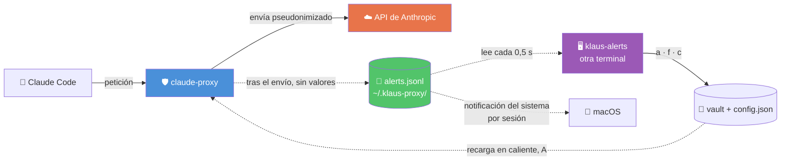

# 🧭 ADR-002: Centinela de fugas y revisión en tiempo real con `klaus-alerts`

> **Issues:** [#188 — este ADR](https://github.com/Ka0s-Klaus/klaus-proxy-local/issues/188) · [#184 — la feature](https://github.com/Ka0s-Klaus/klaus-proxy-local/issues/184) · [#185 — el spike](https://github.com/Ka0s-Klaus/klaus-proxy-local/issues/185) · [#187 — backend (A y B)](https://github.com/Ka0s-Klaus/klaus-proxy-local/issues/187) · [#189 — interfaz](https://github.com/Ka0s-Klaus/klaus-proxy-local/issues/189)
> **Estado:** ✅ Aceptado · pendiente de implementación

---

## 📋 Contexto

El proxy pseudonimiza lo que conoce: el vault, las reglas de `config.json` y los patrones con forma reconocible (claves, tokens, emails). Un dato **nuevo** sin regla sale en claro en la petición en la que aparece. Hoy solo se detecta si alguien ejecuta `klaus-scan` a mano y reinicia el proxy.

Hay dos agravantes:

1. **Cada petición reenvía el historial completo de la sesión.** Si el dato se escapa en el turno 5, vuelve a salir en el 6, 7 y así hasta el final. Lo que importa es cuánto tarda en cerrarse la fuga.
2. **Las reglas aprobadas no se aplican hasta reiniciar el proxy.** Hay una ventana en la que lo que ya sabes sigue saliendo en claro (#15, recogido en #179).

Este ADR recoge las decisiones para cerrar esas dos brechas.

---

## 🔍 Opciones evaluadas

### Decisión 1: cuándo actuar sobre un dato nuevo

| Opción | Cuándo actúa | Ventaja | Inconveniente |
|---|---|---|---|
| **A. Recarga en caliente** | — | Una regla aprobada se aplica en la siguiente petición | Por sí sola no detecta nada |
| **B. Centinela tras el envío** ✅ | Segundos después | No añade latencia ni bloquea. Reduce la fuga a una petición | La primera petición con el dato ya ha salido |
| **C. Pseudonimizar al detectar** | Antes de enviar | El modelo nunca ve el valor real | Falsos positivos que alteran el texto. Añade latencia |
| **D. Bloquear y pedir aprobación** | Antes de enviar | Ninguna fuga | Interrumpe el trabajo. Con falsos positivos, la gente desactiva el proxy |

**Decisión: A + B.** C y D quedan fuera de alcance hasta tener datos de B en uso real. Con 9 casos reales no hay base para pseudonimizar antes de enviar: sería adivinar.

### Decisión 2: umbral de confianza

| Umbral | Avisos sin cubrir (30 días) | Comentario |
|---|---|---|
| HIGH | 9 | Pocos avisos, todos sensibles en la revisión |
| **MEDIUM** ✅ | 82 | Incluye los HIGH. Hay ruido en `corporate-domain` sin revisar |
| Todas (incluye LOW) | 97 | Casi todo ruido (`issue-key`) |

**Decisión: MEDIUM** (todo salvo LOW), por decisión del autor, configurable en `config.json`. Se revisará una muestra de `corporate-domain` antes de dar el ruido por aceptado.

### Decisión 3: cómo agrupar los avisos

| Opción | Problema |
|---|---|
| Una notificación por valor | En el spike, una sesión llegó a 45 valores: 45 notificaciones |
| **Una notificación por sesión** ✅ | Muestra el recuento. El detalle está en la interfaz |

**Decisión: agrupar por sesión** (directorio de trabajo + día), con un solo aviso por tanda. Un mismo valor avisa como mucho una vez por sesión.

### Decisión 4: dónde se revisan los avisos

| Opción | Ventaja | Inconveniente |
|---|---|---|
| Solo notificaciones del sistema | Sin nada que instalar | No permiten actuar ni ver el contexto |
| Integrado en la terminal del proxy | Todo en un sitio | Mezcla la salida del proxy con la interfaz |
| **Comando aparte `klaus-alerts`** ✅ | Independiente del proxy. Se puede cerrar sin afectarlo | Una terminal más |

**Decisión: `klaus-alerts` en su propia terminal.** Las notificaciones del sistema avisan; la interfaz decide.

### Decisión 5: tecnología de la interfaz

| Opción | Ventaja | Inconveniente |
|---|---|---|
| Textual | Interfaz cuidada | Dependencia pesada en el venv del proxy |
| **`curses` (librería estándar)** ✅ | Cero dependencias nuevas | Más trabajo para la interfaz |

**Decisión: `curses`.** El proxy solo tiene tres dependencias, y no compensa añadir una pesada para una pantalla.

### Decisión 6: acciones de la interfaz

| Tecla | Acción | Salvaguarda |
|---|---|---|
| `a` | Aprobar: vault y `config.json` | Pide confirmación y muestra el valor **enmascarado** |
| `f` | Falso positivo: `pseudo_pattern_ignore` | Deja rastro en `alerts.jsonl` |
| `s` | Ignorar en esta sesión | Solo afecta a la sesión |
| `v` | Ver el contexto | Enmascarado por defecto; nunca se escribe en un fichero |
| `c` | Silenciar la categoría | Deja rastro y es reversible desde `config.json` |

**Decisión: estas cinco acciones.** `a` es la de más riesgo: aprobar un valor sin mirarlo podría dejar en el vault algo que no es sensible. Por eso pide confirmación y no muestra el valor en claro.

---

## ✅ Decisión

Un **centinela tras el envío (B)** con umbral MEDIUM, avisos agrupados por sesión, y una **interfaz `curses`** separada del proxy (`klaus-alerts`) que los revisa en tiempo real. Todo ello con **recarga en caliente de reglas (A)**, para que cada aprobación surta efecto en la siguiente petición.

---

## 🔧 Arquitectura



**Principio de separación:**

- El **proxy solo escribe** avisos, sin valores, en `alerts.jsonl`. No depende de la interfaz.
- La **interfaz solo lee** ese fichero y escribe en el vault y en `config.json`, por las mismas rutas que `klaus-scan`.
- Si la interfaz se cierra o falla, las peticiones siguen igual.

**Formato del aviso** (una línea JSON por aviso, sin valores):

```json
{"ts": "2026-11-06T12:00:00", "session": "/ruta/proyecto|2026-11-06", "category": "corporate-domain", "id": "⟨corporate-domain·a1b2c3d4·11c⟩", "confidence": "MEDIUM", "capture": "20261106_120000_anthropic_payload.json"}
```

---

## ⚠️ Consecuencias

### ✅ Positivas

- Una fuga se queda en **una petición**, en vez de repetirse en todo el historial.
- Coste despreciable: p95 ≈ 2 ms por petición, medido en #185.
- Revisar un aviso no exige reiniciar nada (A).
- Sin dependencias nuevas.

### ⚠️ Trade-offs

- **La primera petición con el dato ya ha salido.** B reduce la fuga, no la impide. Por eso A y la revisión periódica importan tanto.
- **Ruido de MEDIUM sin revisar.** 73 avisos, sobre todo `corporate-domain`.
- **Sesión aproximada:** directorio de trabajo + día. Las capturas no tienen identificador de sesión.
- **Una terminal más** para revisar.

### 🚫 Límites que no resuelve

- Datos sin forma reconocible: nombres de proyecto dentro de una frase, nombres propios sin forma jurídica. Riesgo residual (#179, prioridad 7).
- Emails e IPs no están en la medición del spike.
- La detección de nombres de negocio es parcial en el spike: no ejecuta el modo `enable_business` completo. La implementación debe usar el mismo conjunto que `klaus-scan`.

---

## 🔗 Relación con otras decisiones

- **[[ADR-001-persist-pseudo-literals-config|ADR-001]]:** `config.json` como fuente de verdad de los literales. El centinela y `klaus-alerts` escriben ahí.
- **#179:** modelo de amenazas. Este ADR cubre la amenaza 3 (secretos y datos nuevos en el contexto) y la prioridad 1 (control de salida), en la parte de detección.
- **#185:** spike que valida el coste y el ruido.
- **#187:** implementación del backend.
- **#189:** implementación de la interfaz.

---

## 📅 Revisión

Revisar este ADR cuando:

- Haya datos de B en uso real durante unas semanas.
- Se revise la muestra MEDIUM de `corporate-domain`.
- Se decida si C o D entran en alcance.
