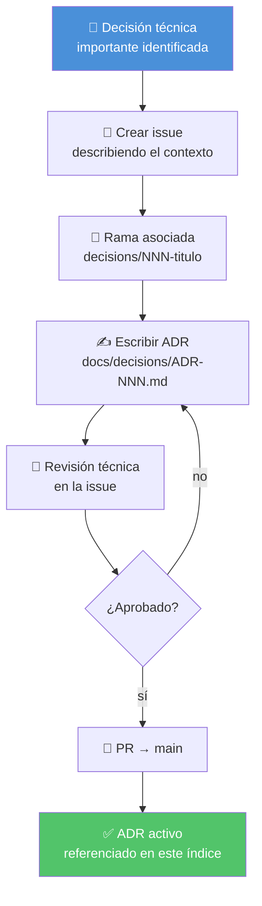

# 🧭 Decisiones (ADRs)

## 📋 Contexto

Aquí se documentan las **decisiones técnicas relevantes** del proyecto en formato ADR (Architecture Decision Record). Como las actas de una reunión importante: no solo qué se decidió, sino por qué, qué alternativas se descartaron y qué consecuencias tiene.

> 💡 **¿Qué es un ADR?** Imagínalo como un post-it gigante que dice: "elegimos X porque Y, descartamos Z porque W, y esto implica Q". El objetivo es que cualquiera que llegue al proyecto en el futuro entienda el contexto sin tener que preguntar.

---

## 📄 ADRs activos

| ID | Título | Estado | Fecha |
|---|---|---|---|
| — | *(primer ADR pendiente)* | — | — |

> 📝 **Nota:** los ADRs se crean aquí, en `docs/decisions/`, como parte del flujo estándar Issue → Rama → Documentación → PR. Cada decisión técnica importante que se tome durante el desarrollo debe quedar registrada aquí antes de cerrar la issue correspondiente.

---

## 🔄 Flujo para crear un ADR



---

## 📐 Plantilla de ADR

```markdown
# 🧭 ADR-NNN: Título de la decisión

## 📋 Contexto
_Por qué surgió esta decisión. Qué problema había._

## 🔍 Opciones evaluadas

### Opción A: nombre
- ✅ Pro: ...
- ❌ Contra: ...

### Opción B: nombre
- ✅ Pro: ...
- ❌ Contra: ...

## ✅ Decisión
**Elegimos Opción X** porque...

## 📌 Consecuencias
- ➕ Lo que ganamos: ...
- ➖ Trade-off aceptado: ...

## 🔗 Referencias
- Issue: #NNN
- PR: #NNN
```

---

## 🔗 Referencias

← [Volver al README principal](../../README.md)
