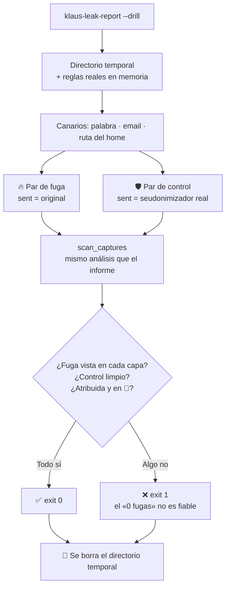

# 🧯 Simulacro de fugas: `klaus-leak-report --drill`

## 📋 Contexto

`klaus-leak-report` cuenta las capturas en las que un dato real ha salido en claro hacia Anthropic. Cuando dice **«0 fugas»** caben dos lecturas:

- ✅ el proxy lo está sustituyendo todo, o
- 💥 el detector se ha roto y ya no ve nada.

Desde fuera son indistinguibles. Es como una alarma de incendios que no ha sonado nunca: puede que no haya habido fuego, o que no tenga pilas. El simulacro **provoca una fuga falsa a propósito** y comprueba que la alarma suena (#171).

## 🔍 Descripción detallada

### ▶️ Uso

```bash
klaus-leak-report --drill
echo $?   # 0 = todo bien · 1 = algo ha fallado
```

Tarda unos segundos: no analiza tus proyectos ni tus capturas.

### 🧪 Qué hace, paso a paso

1. **Crea un directorio temporal** (`klaus-drill-…`, permisos solo para ti) y lo borra al terminar.
2. **Carga tus reglas reales** del proxy: `config.json`, SALT y las reglas que se deducen de tu máquina. Lo hace igual que el informe normal, pero con un vault vacío y solo en memoria.
3. **Siembra un valor canario por capa de detección:**

   | Capa | Canario | Por qué |
   | --- | --- | --- |
   | 🔤 Palabra protegida (`org`) | Palabra inventada `klausdrill<hex>`, añadida solo a las reglas en memoria | Prueba la frontera de palabra (#158) |
   | 📧 Email | `drill.<hex>@klaus-drill.invalid` | Prueba la regex de email (`.invalid` no existe nunca) |
   | 🏠 Ruta del home | Tu prefijo de home real, tal como lo tiene la regla | Es lo que más importa proteger |

4. **Genera dos pares `original` / `sent`:**
   - 🔥 **Fuga simulada:** el `sent` es idéntico al `original`, como si el proxy no hubiera hecho nada. El detector **tiene** que verlo.
   - 🛡️ **Control:** el `sent` lo genera el **seudonimizador real**. **No** debe haber fuga.
5. **Pasa los dos pares por el mismo análisis que `klaus-leak-report`** (`scan_captures`, el verificador por pares) y comprueba:

   | Comprobación | Si falla, significa… |
   | --- | --- |
   | 🔥 El detector ve la fuga simulada (por capa) | El detector está ciego en esa capa: un «0 fugas» no es fiable |
   | 🛡️ El proxy sustituye el canario (por capa) | El proxy dejaría salir ese tipo de dato (p. ej. regex de email desactivadas) |
   | 🛡️ La captura de control sale limpia | El proxy y el detector no están de acuerdo: o falta una regla o hay un falso positivo |
   | 📁 Atribución por directorio de trabajo | Las fugas no se asignarían a su proyecto |
   | 🔴 El informe lo marcaría como crítico | La fuga se detecta pero no se vería en el semáforo |

### 🔒 Garantías

- **No toca nada tuyo:** ni `~/.klaus-proxy/captures/`, ni el vault, ni la caché, ni `informes/`.
- **No muestra valores:** la salida solo dice qué capa ha pasado o fallado.
- **No hace peticiones de red.**

### 📟 Salida de ejemplo

```text
🧯 Simulacro de fugas (directorio temporal, sin tocar tus capturas)
  ✅ 🔥 El detector ve la fuga simulada: palabra protegida
  ✅ 🛡️ El proxy sustituye el canario: palabra protegida
  ✅ 🔥 El detector ve la fuga simulada: email
  ✅ 🛡️ El proxy sustituye el canario: email
  ✅ 🔥 El detector ve la fuga simulada: ruta del home
  ✅ 🛡️ El proxy sustituye el canario: ruta del home
  ✅ 🛡️ La captura de control, seudonimizada por el proxy, sale limpia
  ✅ 📁 La captura se atribuye a su proyecto por el directorio de trabajo
  ✅ 🔴 El informe marcaría el proyecto como crítico
✅ El detector y el proxy responden como deben.
```

Si no hay ninguna regla de ruta (instalación sin home detectado), la capa 🏠 no aparece.

### 🗓️ Cuándo lanzarlo

- Después de **actualizar Klaus** o de tocar el seudonimizador o el verificador.
- Después de **cambiar `config.json`**, por ejemplo al desactivar regex o aprobar reglas en bloque.
- Antes de presentar un informe de «0 fugas» a alguien: es la prueba de que el cero significa algo.
- Como paso de CI no sirve tal cual: depende de tu configuración local. Los tests unitarios (`tests/test_leak_report.py`) cubren lo mismo con una configuración de prueba.

## 🔄 Flowchart / Diagrama



## ✅ Criterios de aceptación / Conclusiones

- ✅ Pasa en una instalación sana y sale con `0`.
- ✅ Si el detector no ve la fuga, o el proxy no cubre un canario, sale con `1` y dice qué capa ha fallado.
- ✅ No escribe nada fuera del directorio temporal ni muestra valores.
- ✅ Tests: instalación sana, detector «ciego», proxy que deja de sustituir, CLI sin efectos secundarios y código de salida.

## 🔗 Referencias

- [Guía de uso: informe de fugas por proyecto](../USER_GUIDE.md#-informe-de-fugas-por-proyecto)
- [Runbook técnico del proxy](../anthropic-audit-proxy.md)
- [Índice de guías](./README.md) · [README principal](../../README.md)
- Issues: #171 (simulacro), #146 (`klaus-leak-report`), #158 (frontera de palabra)
