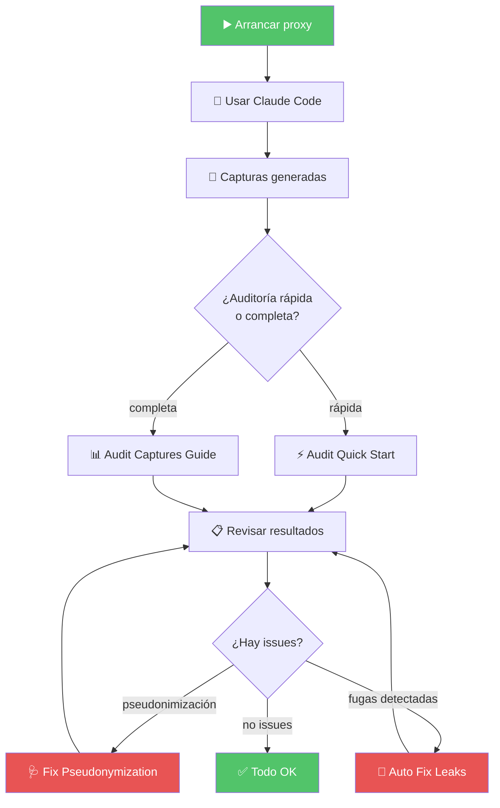

# 📖 Guías

## 📋 Contexto

Todo lo que necesitas para **usar, operar y solucionar problemas** de Klaus Proxy Local. Organizado por audiencia, como una biblioteca: primero encuentra tu sección, luego el libro.

---

## 🚀 Para empezar (nuevos usuarios)

| Guía | Tiempo estimado | Descripción |
|---|---|---|
| [⚡ Quick Start](../QUICK_START.md) | 2 min | Instalación y primer uso |
| [📋 User Guide](../USER_GUIDE.md) | 10 min | Guía completa de uso cotidiano |
| [🎯 Klaus Menu](../KLAUS_MENU.md) | 3 min | Menú interactivo de comandos |

---

## 🔍 Para auditores

| Guía | Descripción |
|---|---|
| [🔎 Audit Quick Start](../AUDIT_QUICK_START.md) | Auditoría rápida de payloads capturados |
| [📊 Audit Captures Guide](../AUDIT_CAPTURES_GUIDE.md) | Análisis multi-modo completo de capturas |
| [📈 Generate Reports Guide](../GENERATE_REPORTS_GUIDE.md) | Generación automática de informes |
| [🔍 Audit All Payloads](../AUDIT_ALL_PAYLOADS.md) | Auditoría masiva de todos los payloads |

---

## 🔧 Para troubleshooting y remediación

| Guía | Descripción |
|---|---|
| [🛠️ Troubleshooting](../TROUBLESHOOTING.md) | Solución de problemas comunes |
| [🩺 Fix Pseudonymization](../FIX_PSEUDONYMIZATION.md) | Diagnosticar y corregir payloads no pseudonimizados |
| [🚨 Auto Fix Leaks Guide](../AUTO_FIX_LEAKS_GUIDE.md) | Detección y corrección automática de fugas |
| [🔍 Inspect Anonymizations](../INSPECT_ANONYMIZATIONS.md) | Revisar el estado de las anonymizaciones |

---

## 🔐 Para gestión del vault

| Guía | Descripción |
|---|---|
| [➕ Add to Vault Automatic](../ADD_TO_VAULT_AUTOMATIC.md) | Añadir secretos al vault de forma automática |
| [⚡ Quick Vault Add](../QUICK_VAULT_ADD.md) | Añadir secretos al vault rápidamente |

---

## 🛠️ Para desarrollar

| Guía | Descripción |
|---|---|
| [⚙️ Entorno de desarrollo](../setup.md) | Tests, lint, probar cambios en el proxy y flujo de releases |
| [🔌 Runbook técnico](../anthropic-audit-proxy.md) | Referencia completa: captura, pseudonimización, verificación y variables |

---

## 🔄 Flujo típico de un auditor

---

## 🗄️ Guías antiguas

Las guías de funcionalidades retiradas (monitor TUI, publicación en PyPI…) están en el [archivo histórico](../archive/README.md).

---

## 🔗 Referencias

← [Volver al README principal](../../README.md)
