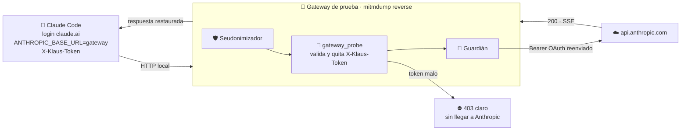
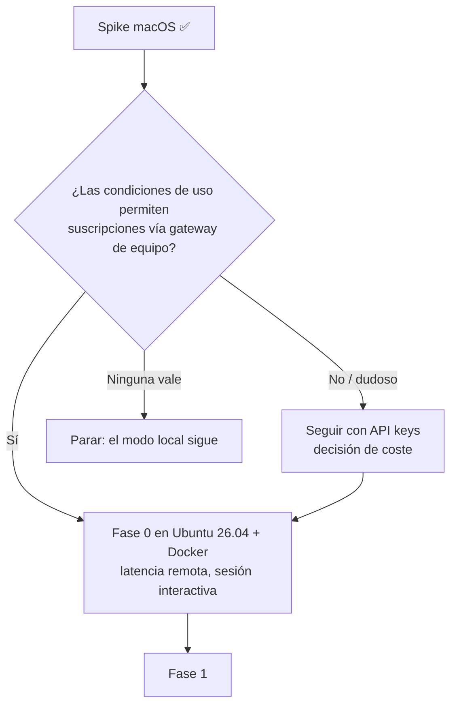

# 🧪 Spike fase 0 de la versión servidor: R1/R2/R3 en local (macOS)

> **Issue:** #172 · **Evaluación de la que forma parte:** #131 · **Fecha:** 2026-11-03 · **Estado:** ✅ completado en macOS · ⏳ pendiente Ubuntu 26.04 y Docker (D9)

## 📋 Contexto

La evaluación de la versión servidor (#131) concluye que es viable. Antes de construir nada había que despejar el **riesgo principal (P1/R1)**: ¿funciona una suscripción de claude.ai (Pro/Max) a través de un gateway propio? Si no, el equipo necesitaría API keys y la decisión pasaría a ser de coste.

Este spike adelanta la parte de la fase 0 que se puede hacer en un portátil, sin construir nada del producto. Es como probar que la llave entra en la cerradura antes de encargar la puerta.

## 🔍 Descripción detallada

### 🧰 Montaje

| Pieza | Detalle |
| --- | --- |
| 🖥️ Máquina | macOS (Darwin 25.6), portátil del autor |
| 🌉 Gateway | `mitmdump` 12.3.1 `--mode reverse:https://api.anthropic.com`, en `127.0.0.1:18899`, HTTP local |
| 🧩 Addons | `anthropic_payload_pseudonymize` → `gateway_probe` (medición) → `klaus_pseudo_guard`. **Sin** `anthropic_payload_capture` ni `klaus_tls_passthrough` (P12) |
| 🔐 Vault | Temporal (`ANTHROPIC_PSEUDO_VAULT`), borrado al terminar |
| 🤖 Cliente | Claude Code 2.1.317, **login de claude.ai** (sin `ANTHROPIC_API_KEY`), `claude -p` con un prompt trivial |
| ⚙️ Variables del cliente | `ANTHROPIC_BASE_URL=http://127.0.0.1:18899`, `ANTHROPIC_CUSTOM_HEADERS="X-Klaus-Token: <aleatorio>"`, `NO_PROXY=127.0.0.1,localhost` |
| 📏 Línea base | El mismo `claude -p` por el camino actual: `HTTPS_PROXY` → `claude-proxy` local en `:8899` |

El addon de medición **no guarda cuerpos ni credenciales**. Solo registra nombres de cabecera, el esquema de `Authorization`, si se declara el beta de OAuth, el estado del token del gateway, si el home o el usuario salen en claro, el estado HTTP y los tiempos.

Para repetirlo:

```bash
python3 scripts/spike_131/run_spike.py --runs 3
```

### 📊 Resultados

#### R1 — Suscripción de claude.ai a través del gateway: ✅ funciona (técnicamente)

| Ejecución | Esquema de auth | Beta OAuth | `x-api-key` | HTTP | Respuesta correcta |
| --- | --- | --- | --- | --- | --- |
| 1ª tanda (3 llamadas) | `Bearer` | sí | no | 200 ×3 | ✅ ×3 |
| 2ª tanda (3 llamadas) | `Bearer` | sí | no | 200 ×3 | ✅ ×3 |

- Claude Code **envía su token OAuth a un `ANTHROPIC_BASE_URL` que no es de Anthropic**, sin avisar ni pedir confirmación.
- La API **acepta el token reenviado** por el gateway: 6 de 6 respuestas correctas.
- El token de Anthropic **atraviesa el gateway**. El gateway podría leerlo, así que el servidor pasa a ser custodio de credenciales en tránsito (refuerza P3).

> ⚖️ **Lo que este spike NO responde:** si las **condiciones de uso** de las suscripciones de claude.ai permiten usarlas a través de un gateway propio compartido por un equipo. Que funcione técnicamente no significa que esté permitido. Es una decisión que necesita revisión humana, y en EFDEF se **escala al LP** por tener implicaciones legales. Bloquea pasar a la fase 1.

#### R2 — Cabecera propia por usuario: ✅ funciona, con un hallazgo de diseño

| Comprobación | Resultado |
| --- | --- |
| `X-Klaus-Token` llega en todas las peticiones observadas | ✅ 17/17: 6 con el token bueno y 11 con el malo, todas `POST /v1/messages` |
| El gateway la quita antes de reenviar | ✅ nunca llegó a Anthropic |
| Token incorrecto → rechazo en el gateway | ✅ sin llegar a Anthropic |

**🔎 Hallazgo: el gateway debe rechazar con 403, no con 401.**

| Código de rechazo | Comportamiento de Claude Code |
| --- | --- |
| ❌ **401** | Interpreta que **su credencial de Anthropic** no vale y **reintenta en bucle**: 10 reintentos en 180 s, hasta que se cortó. El usuario no ve el motivo |
| ✅ **403** | Falla en **~4,3 s** con un mensaje claro: `API Error: 403 klaus-gateway: X-Klaus-Token ausente o incorrecto` |

Decisión para el diseño: **403 con un mensaje que nombre al gateway**. El 401 queda reservado para Anthropic.

⚠️ **Limitación:** solo se ha probado `claude -p`, que hace una única petición `POST /v1/messages`. Falta comprobar una sesión interactiva larga (más rutas, compactación, subagentes).

#### R3 — Latencia: ✅ sin sobrecoste medible en local (indicativo)

| Camino | Tiempos de `claude -p` (ms) | Mediana |
| --- | --- | --- |
| 🌉 Gateway (modo reverse) | 6341 · 5572 · 5504 | **5572 ms** |
| 📏 Actual (`HTTPS_PROXY` → proxy local) | 5526 · 6033 · 6179 | **6033 ms** |

- La diferencia es ruido (n=3). Los dos caminos ejecutan la misma seudonimización, así que el modo reverse no añade nada propio.
- **El dato interesante está dentro del gateway.** El rechazo 403, que se genera localmente, tarda **~660 ms** desde que llega la petición, para un cuerpo de ~53 KB. Ese es el coste de la seudonimización con las reglas reales del autor, cientos de ellas. Hoy ya se paga en el modo local; en el servidor se pagaría **por cada petición de cada usuario** y hay que vigilarlo (P9).
- Las respuestas SSE se reciben **completas** antes de entregarse: el primer byte y el final llegan casi a la vez. Es el comportamiento actual del seudonimizador (lo dice su docstring), no del modo reverse.
- **No medido:** la latencia de red a un servidor remoto. Eso es justo lo que aportan la máquina Ubuntu y Docker (D9).

#### Extra — La seudonimización se aplica en modo reverse: ✅

| Comprobación | Resultado |
| --- | --- |
| Home del autor en claro hacia Anthropic | ❌ nunca (0/17) |
| Usuario del sistema en claro | ❌ nunca (0/17) |
| Guardián (`klaus_pseudo_guard`) | Sin bloqueos: el seudonimizador vio todas las peticiones |

Se confirma lo que #131 daba por supuesto: con `keep_host_header` desactivado, el `Host` llega como `api.anthropic.com` y los addons lo tratan igual que hoy.

### 🧹 Higiene del spike

- Vault temporal borrado al terminar. Directorios temporales eliminados tras extraer las cifras de este informe.
- `~/.klaus-proxy/config.json` sin cambios: su última modificación es anterior al spike.
- La línea base pasa por el proxy local, así que sus 3 llamadas quedan en las capturas normales, como cualquier uso.

## 🔄 Flowchart / Diagrama





## ✅ Criterios de aceptación / Conclusiones

**Recomendación: 🟡 seguir, condicionado.**

1. ✅ **Técnicamente, R1 está despejado.** Una suscripción de claude.ai funciona a través de un gateway propio en modo reverse, con la seudonimización activa y sin sobrecoste medible.
2. ⚖️ **Bloqueante antes de la fase 1:** revisar las condiciones de uso de las suscripciones para este uso. Va al **LP**, por sus implicaciones legales. Si no está permitido, la alternativa es la rama «API keys».
3. 🔧 **Decisión de diseño nueva:** el gateway rechaza con **403** y un mensaje propio, nunca con 401.
4. ⏳ **Para cerrar la fase 0** (D9) falta repetir en Ubuntu 26.04 y Docker. Hay que añadir latencia de red real, una sesión interactiva larga y la carga de la seudonimización con varios usuarios (~660 ms por petición con las reglas del autor).
5. 🔐 **Riesgo reforzado (P3):** el gateway ve el token OAuth de cada usuario en tránsito. Tiene que constar en la DPIA y en el modelo de amenazas.

Criterios de #172:

- [x] Informe con método, resultados de R1/R2/R3 y recomendación
- [x] Scripts versionados para repetirlo (`scripts/spike_131/`)
- [x] Resumen comentado en #131
- [x] Enlazado desde el `README.md`

## 🔗 Referencias

- Scripts: [`run_spike.py`](../../scripts/spike_131/run_spike.py) · [`gateway_probe.py`](../../scripts/spike_131/gateway_probe.py)
- Seudonimizador: [`anthropic_payload_pseudonymize.py`](../../src/anthropic_payload_pseudonymize.py) · Guardián: [`klaus_pseudo_guard.py`](../../src/klaus_pseudo_guard.py)
- [Índice de informes](./README.md) · [README principal](../../README.md)
- Issues: #131 (evaluación de la versión servidor: P1, P3, P9, P12, D9), #172 (este spike)
