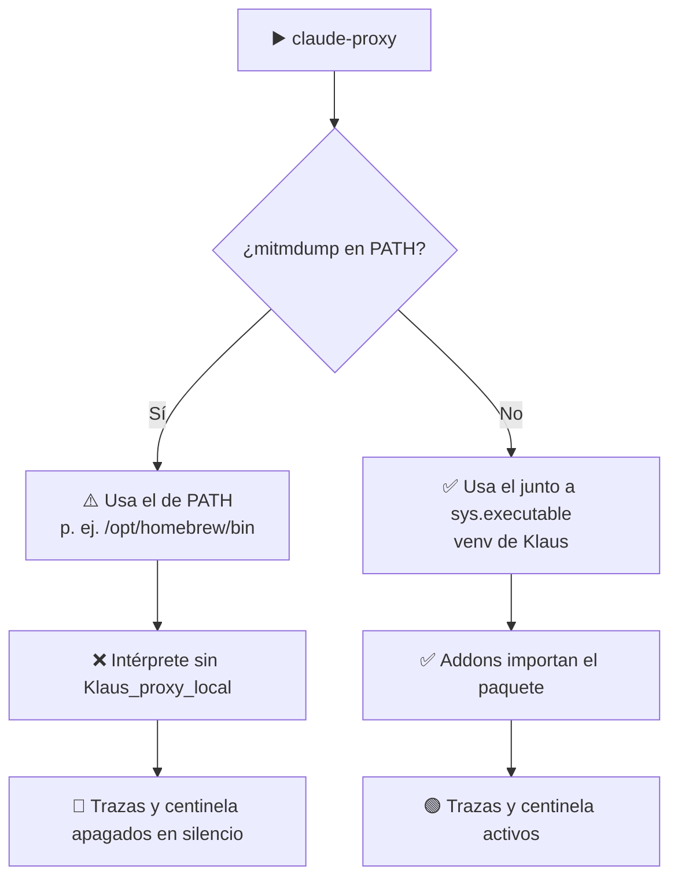

# 🚨 Incidencia: módulos `Klaus_proxy_local` no importables desde `mitmdump`

> Issue: [#252](https://github.com/Ka0s-Klaus/klaus-proxy-local/issues/252) · Estado: 📝 **documentada**. El cambio de código está propuesto, sin decidir ni aplicar.

## 📋 Contexto

En una máquina cliente, el proxy arranca y audita, pero dos piezas dejan de funcionar:

- 🧾 **Trazas** (`klaus-trazas`): no se registra ninguna traza de `/v1/messages`. CLAUDE.md exige instrumentar toda ejecución con IA.
- 🛰️ **Centinela de fugas**: no analiza las peticiones, así que no emite avisos.

La pseudonimización y la captura sí siguen activas. El fallo es **silencioso**: el proxy no avisa al arrancar, y el error solo aparece en el log del addon.

Además, en esa misma máquina el cliente de Claude **no llega a conectar** por otro motivo, documentado en la sección 🔐.

---

## 🔍 Descripción detallada

### 1. Síntoma en el log

```
[klaus-trazas] módulo no disponible: No module named 'Klaus_proxy_local'
[anthropic-pseudo] WARN centinela no disponible: ModuleNotFoundError: No module named 'Klaus_proxy_local'
```

Ambos mensajes salen del proceso `mitmdump`, porque los addons se ejecutan dentro de él.

### 2. Causa raíz (verificada)

El launcher arranca `mitmdump` con la función `mitm_executable` (`src/Klaus_proxy_local/certs.py`):

```python
found = shutil.which(name)          # 1º: PATH
if found:
    return found
sibling = Path(sys.executable).parent / name   # 2º: junto al Python de la venv
```

Si `mitmdump` está en PATH, gana ese binario, aunque no sea el de la venv. En la máquina afectada:

| Comprobación | Resultado |
|---|---|
| `which -a mitmdump` | `/opt/homebrew/bin/mitmdump` (única coincidencia) |
| `head -1` del binario | Cabecera Mach-O: es un ejecutable nativo, no un script con shebang de la venv |
| `~/.local/share/klaus/venv/bin/python -c "import Klaus_proxy_local"` | `OK` |
| Python del sistema: `import Klaus_proxy_local` | `ModuleNotFoundError` (mismo error del log) |

Conclusión: el `mitmdump` de Homebrew se ejecuta con un intérprete que no tiene el paquete. Los addons fallan al importar, y el error se registra y se ignora.

> ⚠️ En esa máquina no se llegó a ver el proceso en marcha (`pgrep -fl mitmdump` no devolvió nada en el momento de la comprobación). La causa se deduce de la resolución del binario y del error del log, que coinciden.

### 3. Factor agravante: instalación desfasada

La venv de la máquina de referencia tiene `klaus_proxy_local` **0.10.0** registrado en sus metadatos, mientras el repo está en **0.12.3**. Funciona porque la instalación es editable y apunta al repo. Una instalación no editable podría faltar o ser de otra versión.

### 4. Flujo de resolución del binario



### 5. Impacto

| Área | Impacto | Gravedad |
|---|---|---|
| 🧾 Trazas | Sin registro de ejecuciones con IA; incumple CLAUDE.md | 🔴 Alta |
| 🛰️ Centinela | Sin alertas de datos nuevos en claro | 🔴 Alta |
| 🔒 Pseudonimización y captura | Siguen funcionando | 🟢 Sin impacto |
| 🔁 Arranque del proxy | Sin fallo visible | 🟡 Media (silencioso) |

---

## 🔐 Incidencia relacionada: `401` del gateway

En la misma máquina, las llamadas `POST /v1/messages?beta=true` van al gateway corporativo (host de `ANTHROPIC_BASE_URL`) y reciben `401 Unauthorized` de forma repetida. Las llamadas a `api.anthropic.com` devuelven `200`. Por tanto, el cliente de Claude no llega a conectar.

- 🔍 **Causa probable:** credencial del gateway caducada, incorrecta o ausente en el cliente; o el cliente envía el login OAuth de claude.ai, que el gateway no acepta.
- 🧪 **Descartado:** que el proxy esté alterando las cabeceras de autenticación. El código no reescribe `Authorization` ni `x-api-key`.
- ❓ **Pendiente de confirmar:** el cuerpo de la respuesta 401 y las variables `ANTHROPIC_*` definidas en la máquina (sin valores).

Este problema es **independiente** de la causa raíz anterior.

---

## 🛠️ Verificación en la máquina afectada

Ejecutar y comparar con los resultados esperados:

```bash
which -a mitmdump                                        # ¿hay un mitmdump antes que el de la venv?
pgrep -fl mitmdump                                       # binario que corre de verdad
~/.local/share/klaus/venv/bin/python -c "import Klaus_proxy_local; print('OK')"
```

| Resultado | Interpretación |
|---|---|
| `which -a` muestra un `mitmdump` fuera de la venv **antes** que el de la venv | Confirma la causa raíz |
| `import Klaus_proxy_local` da `OK` con la venv | El paquete está bien; el problema es solo la resolución del binario |

---

## 🧭 Soluciones propuestas (no aplicadas)

**Inmediatas (en la máquina afectada, decisión del responsable):**

1. Anteponer la venv en PATH antes de arrancar: `export PATH="$HOME/.local/share/klaus/venv/bin:$PATH"`.
2. Desinstalar la copia de Homebrew, solo si ninguna otra herramienta la usa.
3. Volver a ejecutar `install.sh` para recrear la venv con la versión actual.

**Definitivas (en el repo; requieren issue, rama y PR):**

1. En `mitm_executable`, buscar primero el `mitmdump` junto a `sys.executable` y solo después PATH.
2. Chequeo al arrancar: comprobar que el intérprete de `mitmdump` importa `Klaus_proxy_local`, y fallar con un mensaje claro si no lo hace.

---

## ✅ Criterios de aceptación / Conclusiones

- ✅ Causa raíz identificada y reproducida con el Python del sistema.
- ✅ Impacto documentado: trazas y centinela inactivos, sin aviso visible.
- ⏳ Cambio de código pendiente de decisión.
- ⏳ Problema 401 del gateway pendiente de la respuesta del servidor y de la configuración de la máquina.

---

## 🔗 Referencias

- [`src/Klaus_proxy_local/certs.py`](../../src/Klaus_proxy_local/certs.py) — `mitm_executable`
- [`src/Klaus_proxy_local/launcher.py`](../../src/Klaus_proxy_local/launcher.py) — construcción del comando `mitmdump`
- [`src/klaus_trazas_addon.py`](../../src/klaus_trazas_addon.py) — import de `Klaus_proxy_local` y aviso de módulo no disponible
- [`docs/trazabilidad.md`](../trazabilidad.md) — especificación de trazas
- [Índice de informes](./README.md)
- [README principal](../../README.md)
