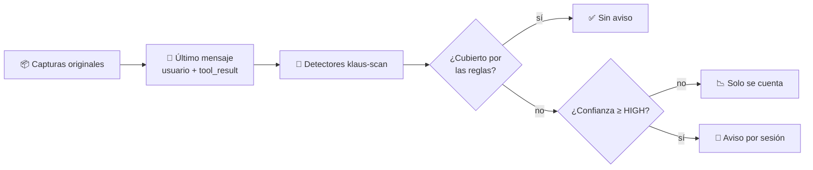

# 🧪 Spike: centinela de fugas (coste y ruido)

> Issue: #185 · Decide: #184 · Estado: ⏳ **medición hecha; falta la revisión manual de la muestra**

## 📋 Contexto

Un dato nuevo sin regla sale en claro en la petición en la que aparece, y se reenvía en todas las siguientes de la sesión. El centinela de #184 (B) avisaría tras cada envío. Antes de construirlo había que saber dos cosas con datos reales:

1. **Coste:** cuánto tarda analizar el texto nuevo de cada petición.
2. **Ruido:** cuántos avisos daría, y cuántos serían falsos positivos.

## 🔍 Método

Script: [`scripts/spike_centinela.py`](../../scripts/spike_centinela.py). Es de solo lectura: no escribe en `captures/`, en el vault ni en `config.json`.

Para cada petición de `/v1/messages` de la ventana:

- Analiza **solo el último mensaje**: el turno del usuario y sus `tool_result`. Es lo nuevo que llega en cada petición.
- Usa los detectores de `klaus-scan`: patrones de secretos y `business_names.detect_line`.
- Descarta los valores que el proxy ya cubriría con sus reglas actuales (`lr.Coverage`).
- Cuenta un **aviso** por valor distinto y **sesión**. Una sesión es el mismo directorio de trabajo y el mismo día; es una aproximación, porque las capturas no tienen un identificador de sesión.
- Filtra por confianza. Por defecto **HIGH**, el umbral de `klaus-scan`.



## 📊 Resultados

Ventana de 30 días, sobre las capturas del autor (1 243 peticiones):

| Medida | Valor |
|---|---|
| Tiempo por petición, detección | p50 **0,12 ms** · p95 **1,97 ms** |
| Tiempo por petición, cobertura | p50 0,00 ms · p95 0,17 ms |
| Tiempo total por petición | p50 **0,12 ms** · p95 **2,06 ms** |
| Peticiones con algún valor detectado | 89 |
| Valores sin cubrir, todas las confianzas | 97 |
| **Valores sin cubrir, desde HIGH** | **9** |
| Sesiones con aviso | 2 (mediana 1,5 avisos; máximo 2) |

Por categoría (desde HIGH): `cloud-project` 8, `corporate-domain` 1.

Con 7 días: 1 103 peticiones, 5 avisos HIGH, 1 sesión con aviso.

**Lectura de la comparativa de umbrales (30 días):** sin filtro de confianza hay 97 valores sin cubrir; desde HIGH quedan 9. Casi todo el ruido de MEDIUM y LOW (`corporate-domain`, `issue-key`) desaparece con el umbral por defecto.

## 🧠 Interpretación

- **Coste: no es un problema.** Un p95 de 2 ms por petición queda muy por debajo de cualquier latencia perceptible. El análisis puede correr en segundo plano sin preocupación.
- **Ruido: bajo con HIGH, pero la muestra es pequeña.** Hay 9 avisos en 30 días, de solo 2 valores distintos. Con tan pocos casos no se puede dar una tasa de falsos positivos fiable. Solo se sabe que, en estos datos, el umbral HIGH no produce una avalancha.
- **Sobre todo, el dato útil es lo que el proxy ya cubre:** 1 243 peticiones y solo 9 avisos HIGH sin cubrir. Las reglas actuales ya cubren casi todo lo que estos detectores ven.

## ⚠️ Límites del spike

- **No mide lo que ningún detector ve**: nombres de proyecto dentro de una frase, nombres propios sin forma jurídica. Eso sigue siendo un riesgo residual (ver #179, prioridad 7).
- **Solo mira el último mensaje.** Si un dato aparece en un turno anterior y no se detectó entonces, no vuelve a avisar. Por diseño, el centinela analiza lo nuevo de cada petición; un dato ya presente en una petición anterior se habría avisado allí.
- **Business names parcial:** el spike usa `detect_line`, que cubre titulares de copyright y algunas categorías de nombres de negocio. No ejecuta el modo `enable_business` completo del escáner. Un centinela real debería usar el mismo conjunto que `klaus-scan`.
- **Emails e IPs** no están en la medición: se gestionan en `pv.layer_matches`, que no entra en este script.
- **Sesión aproximada:** cwd + día.

## ✋ Revisión manual pendiente (falsos positivos)

Los 9 avisos HIGH hay que clasificarlos a mano. **Solo tú puedes hacerlo**, porque para ver los valores hay que usar `--reveal`, y eso no se debe ejecutar desde Claude Code: lo que se imprime llega al modelo.

En tu terminal:

```bash
python3 scripts/spike_centinela.py --days 30 --reveal --sample 9
```

Para cada línea, marca `V` (dato sensible real) o `F` (falso positivo). Con eso se completa esta sección.

| Resultado | Pendiente |
|---|---|
| Verdaderos positivos | ⏳ |
| Falsos positivos | ⏳ |
| Tasa de falsos positivos | ⏳ (con 9 casos, solo orientativa) |

## 🧭 Recomendación preliminar

1. **Implementar B con umbral HIGH**, tal como está en #184. El coste es despreciable y el ruido medido es bajo.
2. **Mantener C fuera de alcance.** Con tan pocos casos reales no hay base para pseudonimizar antes de enviar; sería adivinar.
3. **Antes de dar B por bueno**, completar la revisión manual de la muestra. Si los falsos positivos superan lo asumible, subir a CRITICAL o revisar las reglas de `corporate-domain` y `cloud-project`.
4. **Volver a medir** con más datos al cabo de unas semanas de uso, porque la muestra actual es muy pequeña.

## ✅ Criterios de aceptación del spike (#185)

- [x] El script no escribe en `captures/`, en el vault ni en `config.json`.
- [x] La salida sin `--reveal` no contiene valores en claro. Solo identificadores `⟨categoría·hash·longitud⟩`.
- [x] p50 y p95 del tiempo por petición medidos en esta máquina.
- [x] Número de avisos por sesión medido.
- [ ] Tasa de falsos positivos sobre la muestra revisada a mano: **pendiente de la revisión del autor**.
- [x] Recomendación explícita sobre B y C, con las cifras que la sustentan.

## 🔗 Referencias

- [`scripts/spike_centinela.py`](../../scripts/spike_centinela.py)
- #184 (la feature que decide este spike) · #179 (modelo de amenazas) · #185 (este spike)
- [Simulacro de fugas](../../docs/guides/LEAK_DRILL.md) (#171, para validar que B detecta lo que debe)
