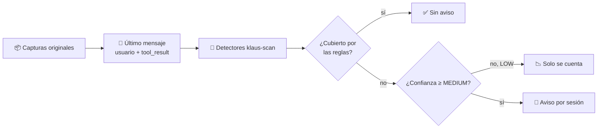

# 🧪 Spike: centinela de fugas (coste y ruido)

> Issue: #185 · Decide: #184 · Estado: ✅ **medido y revisado**. Queda por decidir cómo agrupar los avisos (ver 🧭).

## 📋 Contexto

Un dato nuevo sin regla sale en claro en la petición en la que aparece, y se reenvía en todas las siguientes de la sesión. El centinela de #184 (B) avisaría tras cada envío. Antes de construirlo había que saber dos cosas con datos reales:

1. **Coste:** cuánto tarda analizar el texto nuevo de cada petición.
2. **Ruido:** cuántos avisos daría, y cuántos serían falsos positivos.

## 🔍 Método

Script: [`scripts/spike_centinela.py`](../../scripts/spike_centinela.py). Es de solo lectura: no escribe en `captures/`, en el vault ni en `config.json`.

Para cada petición de `/v1/messages` de la ventana:

- Analiza **solo el último mensaje**: el turno del usuario y sus `tool_result`. Es lo nuevo que llega en cada petición.
- Usa los detectores de `klaus-scan`: patrones de secretos y `business_names.detect_line`.
- Descarta los valores que el proxy ya cubriría con sus reglas actuales (`lr.Coverage`).
- Cuenta un **aviso** por valor distinto y **sesión**. Una sesión es el mismo directorio de trabajo y el mismo día; es una aproximación, porque las capturas no tienen un identificador de sesión.
- Filtra por confianza. **Umbral: MEDIUM** (todo salvo LOW), decidido por el autor.

## 📊 Resultados

### Coste (igual con cualquier umbral)

| Medida | Valor |
|---|---|
| Tiempo por petición, detección | p50 **0,12 ms** · p95 **≈ 2 ms** |
| Tiempo por petición, cobertura | p50 0,00 ms · p95 0,17 ms |
| Tiempo total por petición | p50 **0,12 ms** · p95 **≈ 2,1 ms** |

### Ruido, ventana de 30 días (≈ 1 250 peticiones)

| Umbral | Avisos sin cubrir | Sesiones con aviso | Mediana por sesión | Máximo en una sesión |
|---|---|---|---|---|
| **MEDIUM** (decidido) | **82** | 3 | 2 | **45** |
| HIGH | 9 | 2 | 1,5 | 2 |
| Todas (incluye LOW) | 97 | — | — | — |

Por categoría con MEDIUM: `corporate-domain` 74 · `cloud-project` 8.

Con 7 días y umbral HIGH: 5 avisos, 1 sesión.

### Revisión manual de los 9 avisos HIGH

El autor revisó los 9 avisos HIGH en su terminal, con `--reveal`:

| Resultado | Cantidad |
|---|---|
| **V**, dato sensible real | **9** |
| **F**, falso positivo | **0** |

Son 2 valores distintos: un identificador de proyecto de 6 caracteres (`cloud-project`, 8 avisos) y un dominio corporativo (1 aviso). La muestra es pequeña, así que la tasa de falsos positivos de 0 % es solo orientativa.

### ⏳ Sin revisar: los 73 avisos MEDIUM restantes

Los avisos MEDIUM que se añaden al umbral **no se han revisado**. Son sobre todo `corporate-domain` (74 en total, de los que 1 ya estaba en HIGH). El valor más repetido aparece en 19 peticiones. Antes de dar el ruido por aceptable, hay que revisar una muestra de estos avisos con `--reveal` en la terminal del autor.

## 🧠 Interpretación

- **Coste: no es un problema.** Un p95 de ≈ 2 ms por petición queda muy por debajo de cualquier latencia perceptible. El análisis puede correr en segundo plano sin preocupación.
- **Los avisos HIGH reales son pocos y son datos sensibles.** En 30 días hubo 9, todos confirmados como sensibles por el autor. Eso valida el detector en esta muestra.
- **MEDIUM añade ruido potencial, sobre todo en una sesión.** Pasa de 9 a 82 avisos sin cubrir, y una sesión llega a 45 valores distintos. Si el centinela avisa uno a uno, esa sesión sería ruido puro. Por eso la forma de notificar pesa tanto como el umbral.
- **Lo que el proxy ya cubre es la mayoría.** De 1 252 peticiones, solo 89 tienen algún valor detectado que no está cubierto, y la mayoría ya lo estaba.

## ⚠️ Límites del spike

- **No mide lo que ningún detector ve**: nombres de proyecto dentro de una frase, nombres propios sin forma jurídica. Eso sigue siendo un riesgo residual (ver #179, prioridad 7).
- **Solo mira el último mensaje de cada petición.** Un dato que apareció en una petición anterior ya se habría avisado entonces, si lo hubiera detectado.
- **Business names parcial:** el spike usa `detect_line`, que cubre titulares de copyright y algunas categorías de nombres de negocio. No ejecuta el modo `enable_business` completo del escáner. Un centinela real debería usar el mismo conjunto que `klaus-scan`.
- **Emails e IPs** no están en la medición: se gestionan en `pv.layer_matches`, que no entra en este script.
- **Sesión aproximada:** cwd + día.
- **La ventana se desplaza:** las cifras pueden variar ligeramente entre ejecuciones (1 243 y 1 252 peticiones en dos medidas de 30 días).

## 🧭 Recomendación

1. **Implementar B con umbral MEDIUM**, como pide el autor, porque el coste es despreciable y los avisos HIGH reales confirmados son sensibles.
2. **Agrupar los avisos por sesión, no avisar uno a uno.** Una sola notificación por sesión con el recuento (por ejemplo, «12 datos nuevos sin regla en esta sesión; revísalos con `klaus-scan`»). Así una sesión con 45 valores no se convierte en 45 notificaciones.
3. **Revisar una muestra de los `corporate-domain` MEDIUM** antes de dar el ruido por aceptado. Si son mayoritariamente falsos positivos, ajustar sus reglas en vez de bajar el umbral.
4. **Mantener C fuera de alcance**, por el mismo motivo que antes: no hay base para pseudonimizar antes de enviar.
5. **Volver a medir** al cabo de unas semanas de uso.

## ✅ Criterios de aceptación del spike (#185)

- [x] El script no escribe en `captures/`, en el vault ni en `config.json`.
- [x] La salida sin `--reveal` no contiene valores en claro. Solo identificadores `⟨categoría·hash·longitud⟩`.
- [x] p50 y p95 del tiempo por petición medidos en esta máquina.
- [x] Número de avisos por sesión medido, con el umbral decidido.
- [x] Revisión manual de la muestra HIGH: 9 de 9 sensibles.
- [ ] Revisión manual de la muestra MEDIUM: **pendiente** (ver ⏳ arriba).
- [x] Recomendación explícita sobre B y C, con las cifras que la sustentan.

## 🔗 Referencias

- [`scripts/spike_centinela.py`](../../scripts/spike_centinela.py)
- #184 (la feature que decide este spike) · #179 (modelo de amenazas) · #185 (este spike)
- [Simulacro de fugas](../../docs/guides/LEAK_DRILL.md) (#171, para validar que B detecta lo que debe)
