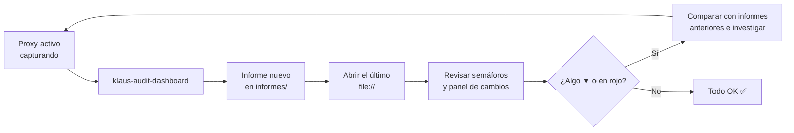

# 🌐 Audit Dashboard

Dashboard HTML de auditoría de Klaus Proxy Local. Ejecuta 5 planes de auditoría sobre las capturas de `~/.klaus-proxy/captures/`, **guarda cada resultado como un informe nuevo en `informes/`** y permite abrir cualquier informe anterior y ver qué ha cambiado respecto al previo.

Se abre directamente en el navegador, **sin servidor, con `file://`**.

> ℹ️ Desde #77 el dashboard ya no se escribe en este directorio. Contiene datos reales de la auditoría y `docs/` está versionado en el repo público; `informes/` está en `.gitignore`.

## 🚀 Cómo usar

```bash
# Ejecutar la auditoría, guardar el informe y abrir el último
klaus-audit-dashboard --open

# Equivalente desde el repositorio
python3 scripts/generate_audit_dashboard.py --open

# Abrir el último informe sin volver a auditar
open informes/audit-dashboard.html        # macOS
xdg-open informes/audit-dashboard.html    # Linux

# Personalizar rutas
python3 scripts/generate_audit_dashboard.py \
  --captures-dir /ruta/capturas \
  --config-dir   /ruta/.klaus-proxy \
  --reports-dir  /ruta/informes \
  --output       /ruta/salida/mi-dashboard.html   # copia adicional del último
```

| Opción | Efecto | Por defecto |
| --- | --- | --- |
| `--captures-dir` | Capturas a auditar | `~/.klaus-proxy/captures` |
| `--config-dir` | Directorio de `config.json` y del vault | `~/.klaus-proxy` |
| `--reports-dir` | Histórico de informes | `informes/` del repo |
| `--output` | Copia adicional del último dashboard, con enlaces relativos al histórico | — |
| `--open` | Abre `audit-dashboard.html` en el navegador | off |
| `--mark-reviewed ID…` | Marca avisos de prompt injection como revisados y genera el informe | — |
| `--note` | Nota que se guarda con `--mark-reviewed` | vacía |

> ⏱️ El plan de tests ejecuta `pytest` completo, así que cada auditoría tarda unos segundos.
>
> 🧪 El venv que crea `install.sh` no incluye pytest (es dependencia de desarrollo). El plan usa, por orden, el intérprete actual si tiene pytest, el `.venv` del repo, o `uv run --no-project --with pytest --with mitmproxy`. Si no hay ninguno, el plan sale ⬜ Sin datos con instrucciones para instalarlo.

## 🗂️ Histórico de informes

Cada ejecución crea en `informes/`, **sin sobrescribir nunca un informe anterior**:

| Fichero | Contenido |
| --- | --- |
| `audit-YYYYMMDD-HHMMSS.json` | Datos del informe: fecha, capturas y los 5 planes |
| `audit-YYYYMMDD-HHMMSS.html` | Dashboard de ese informe, con sus cambios respecto al anterior |
| `audit-dashboard.html` | Copia del último informe: el que abre `--open` |
| `index.js` | Lista de informes que usa el selector (se regenera en cada ejecución) |

- Si dos ejecuciones coinciden en el mismo segundo, la segunda lleva el sufijo `-2`.
- Ficheros `0600`, directorio `0700`. Nada de esto se versiona.
- El histórico no se poda solo: cada informe ocupa unos 30–35 KB de HTML más su JSON. Para limpiarlo, borra los `audit-*` antiguos; el índice se reconstruye en la siguiente ejecución.

### 📂 Selector de informes

En la cabecera, el selector **📂 Informe** lista todos los informes, el último primero, con el icono de su peor estado (✅ ⚠️ 🔴 ⬜). Al elegir uno se abre su HTML.

En un informe antiguo aparece **«Estás viendo un informe anterior · Ir al último»**. Los informes antiguos listan también los más nuevos, porque todos leen el mismo `index.js`.

### 🔁 Cambios respecto al informe anterior

Debajo de las tarjetas, cada informe muestra en qué se diferencia del inmediatamente anterior:

| Tipo de cambio | Ejemplo | Marca |
| --- | --- | --- |
| Estado de un plan | ✅ OK → ⚠️ Revisar | ▲ si mejora, ▼ si empeora |
| Métrica numérica | Fallidos: 0 → 2 (+2) | ▲/▼ en las que tienen sentido de mejora (% pseudonimizadas, % tests superados, fallidos, hosts inesperados…); • en el resto (contadores) |
| Check EFDEF | Check «vault»: ❌ falla | ▲ si pasa a cumplirse, ▼ si deja de cumplirse |
| Hosts inesperados | + `otro-host.example` | ▼ si aparece, ▲ si desaparece |

- La cabecera del panel resume el total: «N cambios · ▲ x a mejor · ▼ y a peor».
- **No se comparan** las series diarias, el detalle por petición ni las distribuciones (hosts, modelos, rutas): cambian en cada ejecución y no reflejan el estado del sistema.
- El primer informe lo indica: «no hay uno anterior con el que comparar».
- Los cambios se calculan al generar cada informe y quedan fijos en su HTML.

## 📋 Planes de auditoría

| Plan | Qué mide | ✅ OK | ⚠️ Revisar | 🔴 Crítico |
| --- | --- | --- | --- | --- |
| 🔐 Seguridad | Hosts capturados y no capturados, secretos redactados, patrones de prompt injection | Sin hosts inesperados ni injection | Patrones de injection | Algún host inesperado |
| 📊 Pseudonimización | % de peticiones `/v1/messages` en las que corrió el pseudonimizador (últimos 30 días), tendencia diaria, vault | ≥ 99 % | ≥ 90 % | < 90 % |
| ⚡ Actividad | Capturas por día (30 días), endpoints, códigos de estado, últimas peticiones | Algún día activo | Sin actividad | — |
| 🧪 Tests | Resultado de `pytest` (⬜ si no hay pytest o no reporta resultados) | 0 fallos y 0 errores | Fallos + errores < 10 % | El resto |
| 📋 EFDEF | Checklist de compliance (secciones 22 y 23) | ≥ 90 % de checks | ≥ 70 % | < 70 % |

### 🛡️ Proyectos protegidos

Qué repos están bajo el paraguas del proxy (#136). Hay una fila por cada repo git de la carpeta de proyectos (`projects_dirs`, hasta 3 niveles), con la misma lógica que `klaus-scan-repos` (#134):

| Columna | Qué muestra |
| --- | --- |
| Repo | Carpeta relativa a la carpeta de proyectos y org/repo de cada remote |
| Estado | ✅ **Protegido**: todo su org/repo está en `pseudo_word_literals` · ✅ **Sin remote**: solo local; su carpeta la protege `pseudo_patterns` · ⚠️ **Nombre genérico** (`docs`, `api`…): no se protege solo · ❌ **Falta proteger** |
| Seudónimo | Lo que ve Anthropic, según el vault; `—` si ese nombre aún no ha salido nunca |
| Última petición | La última captura cuyos remotes de git incluyen ese repo. Claude Code solo los envía en los modos `auto` y `plan` (#68) |

Si falta alguno: `klaus-scan-repos` y reinicia `claude-proxy`. Un nombre genérico privado se añade a mano a `pseudo_word_literals`.

> ⚠️ **Esta tarjeta muestra los nombres reales de tus repos.** El informe es local (`informes/` no se versiona); no compartas el HTML tal cual.

Es informativa: no cambia el estado del plan.

### 🕵️ Fugas por proyecto

Resumen del último informe de `klaus-leak-report` (#146), leído de `informes/fugas/leak-report.json`. La tarjeta no recalcula nada. Por proyecto muestra la cobertura (🟢 ≥ 95 %, 🟡 ≥ 80 %, 🔴 menos o alguna fuga en los últimos 30 días), los valores sin cubrir y las capturas con fugas, con un enlace al informe completo. Si aún no hay informe, indica cómo generarlo. Es informativa: no cambia el estado del plan.

### 🧹 Retención de capturas

El plan de seguridad muestra la retención activa (#132), para que se vea aunque no se lean las notas de la release:

- los días de `capture_retention_days` (por defecto 30), o «Sin límite» si es `0`;
- la fecha de la captura más antigua que se conserva;
- el último borrado al arrancar `claude-proxy`: cuántos pares y cuánto espacio (de `captures/.retention.json`);
- si `capture_originals` es `false`, que no hay originales ni verificación por pares. En ese caso los planes se calculan con las capturas `sent/`.

Es informativo: no cambia el estado del plan.

### 🌐 Hosts capturados y no capturados

- **Hosts capturados:** las capturas de `captures/` por host. Un host es **esperado** si está en `hosts` o en `capture_only_hosts` de `config.json` (#123, #125); si no, sale como ⚠️ Inesperado y el plan pasa a 🔴. La tabla y el estado del plan usan el mismo criterio.
- **Hosts no capturados** (#123): lo que pasó por el proxy **sin pseudonimizar ni capturar**, leído de `proxy.log` y sus rotaciones (`KLAUS_LOG_DIR` o `~/.klaus-proxy/logs`). Por host:
  - **🔒 Túnel:** conexiones que no se descifraron (`TÚNEL host:puerto` en el log); solo se conoce el host y la hora.
  - **🔓 Descifrado:** peticiones que el proxy vio en claro y dejó salir tal cual. Desde v0.6.1 solo se descifra lo que se captura, así que estas filas son histórico (antes de v0.6.0 se descifraba todo, y en v0.6.0 todos los subdominios de `anthropic.com` y `claude.ai`).
  - **Último descifrado / Último túnel:** la última vez de cada modo.

  Es informativa: no cambia el estado del plan. Para auditar un host de la lista, añádelo a `hosts` (se pseudonimiza) o a `capture_only_hosts` (se captura sin pseudonimizar). Solo cubre lo que conserva el log: el actual y hasta 5 rotaciones de 5 MB.

### 🔐 Patrones de prompt injection

El plan de seguridad busca las frases típicas de prompt injection (la lista está en `INJECTION_PATTERNS`, en el generador) en los mensajes de rol `user`. Se analiza lo que escribe el usuario y también **los resultados de herramientas** (ficheros leídos, salidas de comandos, webs), porque es por donde entra un injection real. El system prompt no se analiza.

Cada aviso muestra:

- hora y fichero de la captura, y endpoint;
- patrones encontrados y **origen**: «mensaje del usuario», «resultado de Read/Bash/WebFetch…» o «contenido enviado a count_tokens»;
- la **fuente** de un resultado de herramienta: el fichero, la URL o el comando que lo produjo;
- un fragmento con la primera coincidencia resaltada;
- en cuántas peticiones aparece: las sesiones reenvían el historial, así que un mismo texto cuenta **una sola vez**;
- su **id** y el comando para marcarlo como revisado.

Debajo de los avisos, el dashboard indica qué hacer en cada caso.

#### Qué hacer con un aviso

1. **Mira el origen y el fragmento.** Un aviso no implica un ataque. Si es código, documentación o una conversación *sobre* prompt injection, es un falso positivo.
2. **Falso positivo:** márcalo como revisado y deja de contar para el estado del plan:

   ```bash
   klaus-audit-dashboard --mark-reviewed 3f9c0a1b2d4e 7a8b9c0d1e2f --note "doc del detector"
   ```

   Los ids se guardan con la nota en `audit_injection_reviewed` de `~/.klaus-proxy/config.json`. El dashboard los muestra plegados en «✔️ N avisos marcados como revisados». Para que un aviso vuelva a contar, borra su entrada.
3. **Sospechoso** (un fichero, una web o una salida de comando que da órdenes a Claude):
   - no sigas trabajando en esa sesión de Claude Code;
   - localiza la fuente: el *Origen* del aviso o la captura indicada en `~/.klaus-proxy/captures/original/`;
   - revisa lo que hizo Claude después de leerla (`git status`, `git diff`, comandos ejecutados) y deshaz lo que no hayas pedido;
   - elimina o aísla la fuente (fichero, dependencia, URL) y, si pudo exponer credenciales, rótalas;
   - cuando esté resuelto, márcalo como revisado con una nota.

#### Por qué el repo no dispara el detector

El código, los tests y esta documentación no contienen las frases literales. Los patrones usan `\s+` entre palabras, y los tests las construyen por partes. Si las contuvieran, cada vez que Claude Code leyera esos ficheros a través del proxy aparecería un aviso nuevo, y además distinto en cuanto el fichero cambiara. Un test (`test_detector_sources_do_not_trigger_detector`) lo comprueba.

## 🔄 Flujo de trabajo recomendado



## 📝 Informes en Markdown (`generate_audit_report.py`)

`informes/` también recibe los informes en Markdown del auditor de payloads (`generate_audit_report.py` → `audit_YYYY-MM-DD_HHMMSS.md` y `audit_index.md`), descritos en la [guía de generación de reportes](../../GENERATE_REPORTS_GUIDE.md). Conviven sin conflicto: el dashboard solo lee y escribe los `audit-*` con guion, y el Markdown los `audit_*` con guion bajo.

## 🔗 Referencias

- [📊 Índice de reportes](../README.md)
- [Script generador](../../../scripts/generate_audit_dashboard.py) y lógica del histórico en [`audit_reports.py`](../../../src/Klaus_proxy_local/audit_reports.py)
- [Guía de auditoría](../../guides/README.md)
