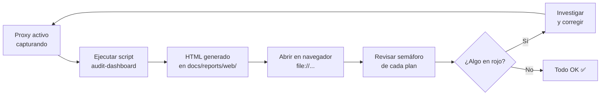

# 🌐 Dashboards Web

Dashboards HTML interactivos generados por el sistema de auditoría automatizada.
Se abren directamente en el navegador — **sin servidor, con `file://`**.

## 📊 Dashboards disponibles

| Dashboard | Descripción | Actualizar |
|---|---|---|
| [🔍 Audit Dashboard](./audit-dashboard.html) | 5 planes de auditoría en tiempo real | `python3 scripts/generate_audit_dashboard.py` |

## 🚀 Cómo usar

```bash
# Generar (lee ~/.klaus-proxy/captures/ y produce el HTML)
python3 scripts/generate_audit_dashboard.py

# Generar y abrir en el navegador directamente
python3 scripts/generate_audit_dashboard.py --open

# Con entrada instalada (pip install -e .)
klaus-audit-dashboard --open

# Personalizar rutas
python3 scripts/generate_audit_dashboard.py \
  --captures-dir /ruta/capturas \
  --output /ruta/salida/mi-dashboard.html
```

## 📋 Planes de auditoría

El dashboard cubre 5 dimensiones:

| Plan | Qué mide |
|---|---|
| 🔐 Seguridad | Hosts capturados, secretos redactados, patrones de prompt injection |
| 📊 Pseudonimización | % de payloads `/v1/messages` pseudonimizados, trend diario, vault |
| ⚡ Actividad | Capturas por día (últimos 30 días), endpoints más usados, recientes |
| 🧪 Tests | Pass rate de pytest, tests pasando/fallando |
| 📋 EFDEF | Checklist de compliance Sección 22 y 23 |

## 🔄 Flujo de trabajo recomendado



## 💡 Notas

- El HTML se genera de cero en cada ejecución — no es incremental.
- El dashboard es un snapshot del momento de la ejecución.
- Los datos de capturas **nunca se suben al repo** (están en `~/.klaus-proxy/`, gitignoreados).
- El HTML generado **sí se versiona** como evidencia del estado del sistema.

## 🔗 Referencias

- [📊 Índice de reportes](../README.md)
- [Script generador](../../../scripts/generate_audit_dashboard.py)
- [Guía de auditoría](../../guides/README.md)
