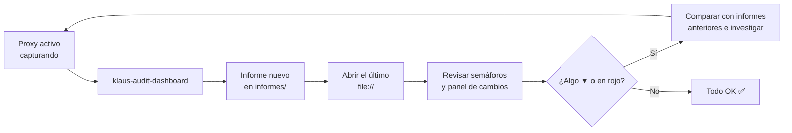

# 🌐 Audit Dashboard

Dashboard HTML de auditoría de Klaus Proxy Local. Ejecuta 5 planes de auditoría sobre las capturas de `~/.klaus-proxy/captures/`, **guarda cada resultado como un informe nuevo en `informes/`** y permite abrir cualquier informe anterior y ver qué ha cambiado respecto al previo.

Se abre directamente en el navegador, **sin servidor, con `file://`**.

> ℹ️ Desde #77 el dashboard ya no se escribe en este directorio. Contiene datos reales de la auditoría y `docs/` está versionado en el repo público; `informes/` está en `.gitignore`.

## 🚀 Cómo usar

```bash
# Ejecutar la auditoría, guardar el informe y abrir el último
klaus-audit-dashboard --open

# Equivalente desde el repositorio
python3 scripts/generate_audit_dashboard.py --open

# Abrir el último informe sin volver a auditar
open informes/audit-dashboard.html        # macOS
xdg-open informes/audit-dashboard.html    # Linux

# Personalizar rutas
python3 scripts/generate_audit_dashboard.py \
  --captures-dir /ruta/capturas \
  --config-dir   /ruta/.klaus-proxy \
  --reports-dir  /ruta/informes \
  --output       /ruta/salida/mi-dashboard.html   # copia adicional del último
```

| Opción | Efecto | Por defecto |
| --- | --- | --- |
| `--captures-dir` | Capturas a auditar | `~/.klaus-proxy/captures` |
| `--config-dir` | Directorio de `config.json` y del vault | `~/.klaus-proxy` |
| `--reports-dir` | Histórico de informes | `informes/` del repo |
| `--output` | Copia adicional del último dashboard, con enlaces relativos al histórico | — |
| `--open` | Abre `audit-dashboard.html` en el navegador | off |

> ⏱️ El plan de tests ejecuta `pytest` completo, así que cada auditoría tarda unos segundos.
>
> 🧪 El venv que crea `install.sh` no incluye pytest (es dependencia de desarrollo). El plan usa, por orden, el intérprete actual si tiene pytest, el `.venv` del repo, o `uv run --no-project --with pytest --with mitmproxy`. Si no hay ninguno, el plan sale ⬜ Sin datos con instrucciones para instalarlo.

## 🗂️ Histórico de informes

Cada ejecución crea en `informes/`, **sin sobrescribir nunca un informe anterior**:

| Fichero | Contenido |
| --- | --- |
| `audit-YYYYMMDD-HHMMSS.json` | Datos del informe: fecha, capturas y los 5 planes |
| `audit-YYYYMMDD-HHMMSS.html` | Dashboard de ese informe, con sus cambios respecto al anterior |
| `audit-dashboard.html` | Copia del último informe: el que abre `--open` |
| `index.js` | Lista de informes que usa el selector (se regenera en cada ejecución) |

- Si dos ejecuciones coinciden en el mismo segundo, la segunda lleva el sufijo `-2`.
- Ficheros `0600`, directorio `0700`. Nada de esto se versiona.
- El histórico no se poda solo: cada informe ocupa unos 30–35 KB de HTML más su JSON. Para limpiarlo, borra los `audit-*` antiguos; el índice se reconstruye en la siguiente ejecución.

### 📂 Selector de informes

En la cabecera, el selector **📂 Informe** lista todos los informes, el último primero, con el icono de su peor estado (✅ ⚠️ 🔴 ⬜). Al elegir uno se abre su HTML.

En un informe antiguo aparece **«Estás viendo un informe anterior · Ir al último»**. Los informes antiguos listan también los más nuevos, porque todos leen el mismo `index.js`.

### 🔁 Cambios respecto al informe anterior

Debajo de las tarjetas, cada informe muestra en qué se diferencia del inmediatamente anterior:

| Tipo de cambio | Ejemplo | Marca |
| --- | --- | --- |
| Estado de un plan | ✅ OK → ⚠️ Revisar | ▲ si mejora, ▼ si empeora |
| Métrica numérica | Fallidos: 0 → 2 (+2) | ▲/▼ en las que tienen sentido de mejora (% pseudonimizadas, % tests superados, fallidos, hosts inesperados…); • en el resto (contadores) |
| Check EFDEF | Check «vault»: ❌ falla | ▲ si pasa a cumplirse, ▼ si deja de cumplirse |
| Hosts inesperados | + `otro-host.example` | ▼ si aparece, ▲ si desaparece |

- La cabecera del panel resume el total: «N cambios · ▲ x a mejor · ▼ y a peor».
- **No se comparan** las series diarias, el detalle por petición ni las distribuciones (hosts, modelos, rutas): cambian en cada ejecución y no reflejan el estado del sistema.
- El primer informe lo indica: «no hay uno anterior con el que comparar».
- Los cambios se calculan al generar cada informe y quedan fijos en su HTML.

## 📋 Planes de auditoría

| Plan | Qué mide | ✅ OK | ⚠️ Revisar | 🔴 Crítico |
| --- | --- | --- | --- | --- |
| 🔐 Seguridad | Hosts capturados, secretos redactados, patrones de prompt injection | Sin hosts inesperados ni injection | Patrones de injection | Algún host inesperado |
| 📊 Pseudonimización | % de peticiones `/v1/messages` en las que corrió el pseudonimizador (últimos 30 días), tendencia diaria, vault | ≥ 99 % | ≥ 90 % | < 90 % |
| ⚡ Actividad | Capturas por día (30 días), endpoints, códigos de estado, últimas peticiones | Algún día activo | Sin actividad | — |
| 🧪 Tests | Resultado de `pytest` (⬜ si no hay pytest o no reporta resultados) | 0 fallos y 0 errores | Fallos + errores < 10 % | El resto |
| 📋 EFDEF | Checklist de compliance (secciones 22 y 23) | ≥ 90 % de checks | ≥ 70 % | < 70 % |

### 🔐 Patrones de prompt injection

El plan de seguridad busca frases típicas de prompt injection (`ignore previous instructions`, `jailbreak`, `you are now`…) en los mensajes de rol `user`: lo que escribe el usuario y **los resultados de herramientas** (ficheros leídos, salidas de comandos, webs), que es por donde entra un injection real. El system prompt no se analiza.

Cada aviso muestra:

- hora y fichero de la captura, y endpoint;
- patrones encontrados y **origen**: «mensaje del usuario», «resultado de Read/Bash/WebFetch…» o «contenido enviado a count_tokens»;
- un fragmento con la primera coincidencia resaltada;
- en cuántas peticiones aparece: las sesiones reenvían el historial, así que un mismo texto cuenta **una sola vez**.

Un aviso no implica un ataque. Si el fragmento es código o documentación que habla de injection (por ejemplo, este mismo generador, que contiene la lista de patrones), es un falso positivo.

## 🔄 Flujo de trabajo recomendado



## 📝 Informes en Markdown (`generate_audit_report.py`)

`informes/` también recibe los informes en Markdown del auditor de payloads (`generate_audit_report.py` → `audit_YYYY-MM-DD_HHMMSS.md` y `audit_index.md`), descritos en la [guía de generación de reportes](../../GENERATE_REPORTS_GUIDE.md). Conviven sin conflicto: el dashboard solo lee y escribe los `audit-*` con guion, y el Markdown los `audit_*` con guion bajo.

## 🔗 Referencias

- [📊 Índice de reportes](../README.md)
- [Script generador](../../../scripts/generate_audit_dashboard.py) y lógica del histórico en [`audit_reports.py`](../../../src/Klaus_proxy_local/audit_reports.py)
- [Guía de auditoría](../../guides/README.md)
