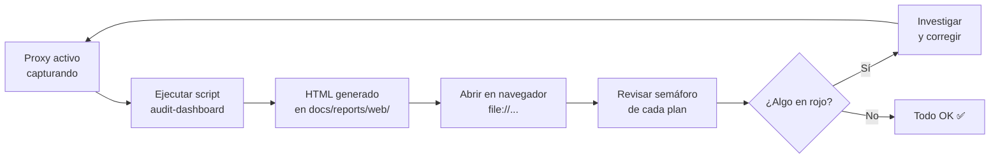

# 🌐 Dashboards Web

Dashboards HTML interactivos generados por el sistema de auditoría automatizada.
Se abren directamente en el navegador — **sin servidor, con `file://`**.

## 📊 Dashboards disponibles

| Dashboard | Descripción | Actualizar |
|---|---|---|
| 🔍 Audit Dashboard → [`informes/audit-dashboard.html`](../../../informes/) (local, no versionado) | 5 planes de auditoría, histórico y cambios respecto al informe anterior | `python3 scripts/generate_audit_dashboard.py` |

> ℹ️ Desde #77 el dashboard ya no se escribe aquí: contiene datos reales de la auditoría y este directorio está versionado en el repo público. Cada ejecución guarda su informe en `informes/` (en `.gitignore`).

## 🗂️ Histórico de informes (#77)

Cada ejecución crea en `informes/`, sin sobrescribir nada:

| Fichero | Contenido |
|---|---|
| `audit-YYYYMMDD-HHMMSS.json` | Datos del informe (los 5 planes) |
| `audit-YYYYMMDD-HHMMSS.html` | Dashboard de ese informe, con sus cambios respecto al anterior |
| `audit-dashboard.html` | Copia del último: el que abre `--open` |
| `index.js` | Lista de informes que usa el selector (se regenera en cada ejecución) |

- **Selector `📂 Informe`** en la cabecera: lista todos los informes (el último primero, con su peor estado) y abre el elegido. En un informe antiguo aparece «Estás viendo un informe anterior · Ir al último».
- **Panel «🔁 Cambios respecto al informe anterior»**: estados de cada plan, métricas que suben o bajan (▲ a mejor, ▼ a peor, • neutras), checks EFDEF que cambian y hosts inesperados nuevos o desaparecidos. Las series diarias y el detalle por petición no se comparan.
- Funciona con `file://`, sin servidor. Ficheros `0600`, directorio `0700`.

## 🚀 Cómo usar

```bash
# Generar (lee ~/.klaus-proxy/captures/ y produce el HTML)
python3 scripts/generate_audit_dashboard.py

# Generar y abrir en el navegador directamente
python3 scripts/generate_audit_dashboard.py --open

# Con entrada instalada (pip install -e .)
klaus-audit-dashboard --open

# Personalizar rutas
python3 scripts/generate_audit_dashboard.py \
  --captures-dir /ruta/capturas \
  --reports-dir /ruta/informes \
  --output /ruta/salida/mi-dashboard.html   # copia adicional del último
```

## 📋 Planes de auditoría

El dashboard cubre 5 dimensiones:

| Plan | Qué mide |
|---|---|
| 🔐 Seguridad | Hosts capturados, secretos redactados, patrones de prompt injection |
| 📊 Pseudonimización | % de payloads `/v1/messages` pseudonimizados, trend diario, vault |
| ⚡ Actividad | Capturas por día (últimos 30 días), endpoints más usados, recientes |
| 🧪 Tests | Pass rate de pytest, tests pasando/fallando |
| 📋 EFDEF | Checklist de compliance Sección 22 y 23 |

## 🔄 Flujo de trabajo recomendado



## 💡 Notas

- El HTML se genera de cero en cada ejecución — no es incremental.
- El dashboard es un snapshot del momento de la ejecución.
- Los datos de capturas **nunca se suben al repo** (están en `~/.klaus-proxy/`, gitignoreados).
- El HTML generado **sí se versiona** como evidencia del estado del sistema.

## 🔗 Referencias

- [📊 Índice de reportes](../README.md)
- [Script generador](../../../scripts/generate_audit_dashboard.py)
- [Guía de auditoría](../../guides/README.md)
