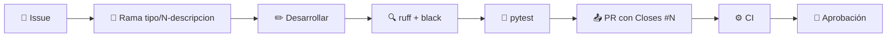

# ⚙️ Entorno de desarrollo — Klaus Proxy Local

> Para **usar** el proxy, sigue el [inicio rápido](./QUICK_START.md) (`install.sh`). Esta guía es para **desarrollar**: clonar, instalar las dependencias de desarrollo, ejecutar los tests y el lint, y probar cambios en el proxy.

---

## 📋 Requisitos

| Requisito | Versión | Para qué |
| --- | --- | --- |
| Python | ≥ 3.10 (CI: 3.10, 3.11, 3.12 y 3.13) | código y tests |
| mitmproxy | ≥ 11.0.2 (se instala como dependencia) | el proxy (`mitmdump`) |
| git | cualquiera | detección del org/repo y flujo de trabajo |

---

## 🚀 Preparar el entorno

```bash
git clone https://github.com/Ka0s-Klaus/klaus-proxy-local.git
cd klaus-proxy-local
python3 -m venv .venv
source .venv/bin/activate
pip install -e ".[dev]"      # paquete + pytest, pytest-cov, ruff y black
```

`.venv` es un entorno de desarrollo independiente del de `install.sh` (`~/.local/share/klaus/venv`). El plan de tests del audit dashboard usa el `.venv` del repo si existe.

---

## 🧪 Tests

```bash
pytest                                         # suite completa
pytest tests/test_anthropic_payload_pseudonymize.py   # un fichero
pytest --cov=src --cov-report=term-missing     # con cobertura
```

- La configuración está en `pyproject.toml` (`[tool.pytest.ini_options]`).
- `tests/conftest.py` añade `src/` al `sys.path`, genera una SALT de prueba y **redirige `config.json` a un fichero temporal**: ningún test escribe en tu `~/.klaus-proxy/config.json`.
- Sin `.venv`, también: `uv run --no-project --with pytest --with mitmproxy python -m pytest`.

---

## 🔍 Lint y formato

```bash
ruff check .          # lint
black --check .       # formato (comprueba)
black .               # formato (aplica)
```

`black` está fijado a `25.11.0` y `ruff` a `<1.0` en `pyproject.toml`, para que el formato sea el mismo en local y en CI.

---

## ▶️ Probar cambios en el proxy

`claude-proxy` ejecuta una **copia inmutable** de los addons (`~/.klaus-proxy/addons/<hash>/`), hecha al arrancar. Para probar un cambio en `src/`:

1. Para `claude-proxy` (Ctrl+C).
2. Vuelve a arrancarlo **desde dentro de un repo**: copia los addons nuevos y los carga.
3. En otra terminal:

   ```bash
   source ~/.klaus-proxy/klaus-env.sh
   export HTTPS_PROXY=http://127.0.0.1:8899
   claude -p "responde solo con la palabra: pong"
   python3 src/anthropic_pair_verify.py      # ¿ha salido algo en claro?
   ```

> ⚠️ No arranques `mitmdump` a mano con `-s src/…`: te saltarías el guardián (`klaus_pseudo_guard.py`), que bloquea cualquier petición que el pseudonimizador no haya procesado, y la copia inmutable de los addons.

---

## 🗺️ Flujo de trabajo

Toda contribución sigue issue → rama → PR (ver [CONTRIBUTING.md](../CONTRIBUTING.md)):



Una release es un tag `vX.Y.Z` sobre `main` y una GitHub Release con las notas de `docs/RELEASE_vX.Y.Z_NOTES.md`; el paquete no se publica en PyPI.

---

## 🔗 Documentos relacionados

- [🔌 Runbook técnico](./anthropic-audit-proxy.md): captura, pseudonimización, verificación y variables de entorno
- [🏗️ Arquitectura](./ARCHITECTURE_DEEP_DIVE.md)
- [⚙️ CI](../.github/workflows/ci.yml)
- [🔒 Seguridad](../SECURITY.md)
